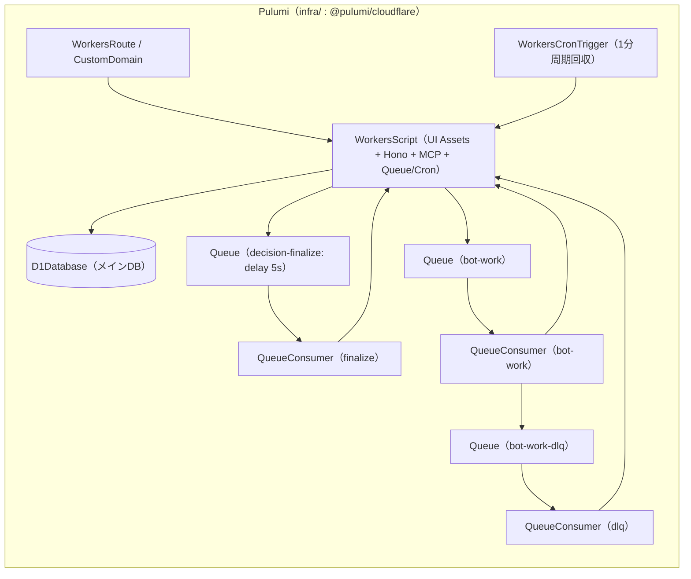
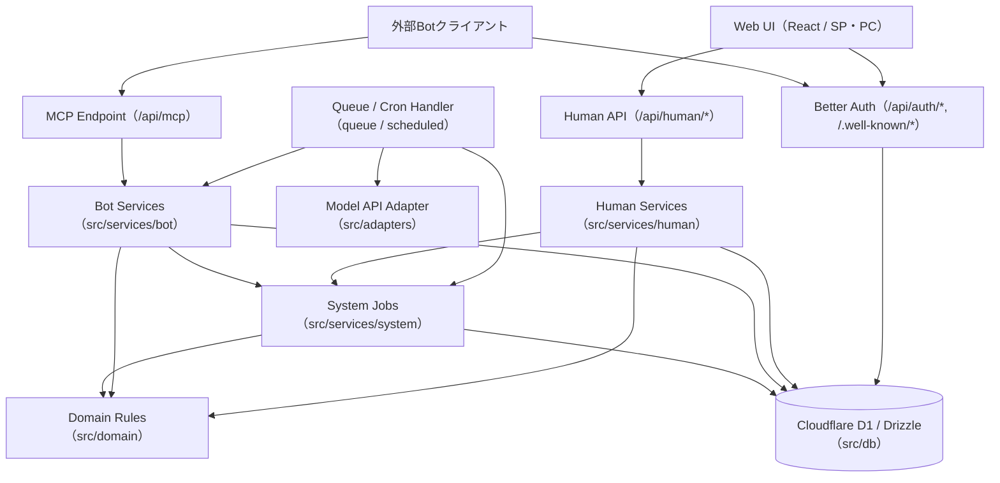

# システム構成・技術スタック仕様

作成日：2026-11-18 ／ 状態：構成基準（未実装）

## 1. 技術スタック

| 区分 | 採用技術 | 役割・境界 | 状態 |
| --- | --- | --- | --- |
| Runtime・ツールチェイン | **Bun** (`bun` / `bun check` / `bun fmt` / `bun lint` / `bun test`) | パッケージ管理・型検査・整形・静的解析・単体/結合テストをBun組み込み機能に統一 | 未実装 |
| クラウド実行基盤 | **Cloudflare Workers**（Static Assets + HTTP + Queue Consumer + Cron） | UI配信・Human API・MCP・ワーカー処理を単一プラットフォームで実行 | 未実装 |
| IaC（構成管理） | **Pulumi** (`@pulumi/cloudflare`, `runtime: bun`, `infra/`) | Workers・D1・Queues・QueueConsumer・Cron・Route をコード管理 | 未実装 |
| Web UI | React + Vite + Tailwind CSS（Workers Static Assets 配信） | SP（360/320px基準）・PC対応のSPA（`/sign-in`・`/consent` 含む） | 未実装 |
| HTTP API / ルーター | **Hono** | `/api/*`・`/.well-known/*` ルーティング、CSRF・認可ミドルウェア | 未実装 |
| MCP Server | `@modelcontextprotocol/server`（MCP TypeScript SDK v2・Stateless Streamable HTTP） | `/api/mcp` でBot向け12ツールを公開 | 未実装 |
| 入力検証 | `Zod` | Human API と MCP JSON Schema の型・制約を共通化 | 未実装 |
| DB / ORM | **Cloudflare D1**（SQLite互換）+ **Drizzle ORM**（`bun test` 時は `bun:sqlite`） | 条件付き原子更新・ガード付き `db.batch`・楽観ロック・冪等キー永続化 | 未実装 |
| 非同期・5秒確定・Worker | **Cloudflare Queues**（`decision-finalize` / `bot-work` / `bot-work-dlq`）+ **Cron Triggers** | 5秒仮確定の満了処理、判断確定イベントからの有界ステップ実行、期限切れ回収 | 未実装 |
| 認証・認可 | **Better Auth** (`better-auth` + Drizzle Adapter + `jwt` + `@better-auth/mcp`) | Human: `/api/auth/*` セッション認証 Bot: OAuth 2.1（`/.well-known/*` 公開）＋ `BotConnection` D1リアルタイム照合 | 未実装 |
| UI E2E検証 | Playwright（`bunx playwright test`） | UI変更時のSP 360px/320px・PC代替操作・誤スワイプ防止検証 | 未実装 |

- 禁止：Bun外のフォーマッター・リンター・単体テストランナー（Prettier / ESLint / Biome / Vitest 等）を追加導入すること
- 禁止：Cloudflareリソースを手動変更のみで運用すること（`infra/` の Pulumi 定義を正とする）
- 禁止：未実証のBot接続経路やデプロイ環境を「対応済」と記載すること

---

## 2. Cloudflare・Pulumi インフラ構成

| Pulumi リソース | 役割・必須設定 |
| --- | --- |
| `cloudflare.WorkersScript`（または `Worker` + `WorkerVersion` + `WorkersDeployment`） | Static Assets（`notFoundHandling: "single-page-application"`, `runWorkerFirst: ["/api/*", "/.well-known/*"]`）、`fetch` / `queue` / `scheduled`、`limits.cpuMs` を構成 |
| `cloudflare.WorkersRoute` / `WorkersCustomDomain` | HTTPS エンドポイント公開（公式MCPクライアント接続・OAuth発見用） |
| `cloudflare.D1Database` | Better Auth（`jwks`・OAuth含む）およびドメイン全テーブルを永続化 |
| `cloudflare.Queue` × 3 | ① `decision-finalize`（`delaySeconds: 5`）、② `bot-work`（再開ジョブ）、③ `bot-work-dlq`（再試行上限超過の退避先） |
| `cloudflare.QueueConsumer` × 3 | `decision-finalize`・`bot-work`・`bot-work-dlq` ごとに `batchSize`・`maxRetries`・`deadLetterQueue` を分離して Worker へ接続 |
| `cloudflare.WorkersCronTrigger` | 1分周期で未処理の期限切れ `provisional`・`work_leases`・`decision_cards` 回収と、未消費 `decisions(consumed_at IS NULL)` 再配送を実行 |

---

## 3. アプリケーションレイヤー境界

- 禁止：Better Auth インスタンスや Drizzle(D1) クライアントをモジュールスコープのシングルトンにすること（リクエスト毎に `env.DB` と `ctx.waitUntil` を渡して生成する）
- 禁止：`/api/mcp` でローカルJWT検証のみを通し D1 の `bot_connections` 照合を省略すること（即時失効・一時停止・スコープ縮小を毎リクエスト強制する、`BOT-02`）
- 禁止：UI・ルーター・MCPハンドラから `src/db/` を直接参照・更新すること
- 禁止：`MCP` ハンドラおよび `Queue / Cron Handler` から `src/services/human/`（採用・見送り・取消・保留・権限変更）を呼ぶこと（`BOT-02`）
- 禁止：モデルAPI秘密鍵・`BETTER_AUTH_SECRET`・接続トークン平文をクライアントバンドル・カード本文・ログ・Gitへ出力すること

---

## 4. ディレクトリ構成

| パス | 責務 | 境界ガードレール |
| --- | --- | --- |
| `src/client/` | React + Tailwind CSS による4画面＋認証/同意画面（`/sign-in`, `/consent`） | ドメイン遷移判定の重複実装禁止 |
| `src/server/routes/` | Hono ルーター（`/api/auth/*`, `/.well-known/*`, `/api/human/*`, `/api/mcp`） | `/api/human/*` 更新系に `trustedOrigins` ベースのCSRF検証を必須化。業務ロジック保持禁止 |
| `src/auth/` | Better Auth 設定（Drizzle Adapter、オーナー制限、`jwt({ disableSettingJwtHeader: true })` + `disabledPaths: ["/token"]`、`@better-auth/mcp`、OAuth同意時の `bot_connections` Upsert） | リクエストスコープ生成・CIMD外部取得時のSSRF防止必須 |
| `src/domain/` | `Task` / `DecisionCard` 状態遷移判定、版・期限チェック、エラーコード定義 | 外部I/O・DB・Cloudflare束縛への依存禁止 |
| `src/services/human/` | 仮確定＋5秒遅延Queue投入、5秒取消、保留、タスク再試行、状況/履歴取得、接続管理 | Better Auth 所有者セッション必須・Bot呼び出し禁止 |
| `src/services/bot/` | タスク・成果操作、占有取得・延長、提案一括登録・差替、確定判断取得、結果記録 | `bot_connections` D1照合・`workspace_id`・`scopes`・`expected_version`・`request_id` 必須 |
| `src/services/system/` | 5秒猶予満了の確定処理（Queue・Cron・読取時オンデマンド共通）、期限切れ整理、DLQ失敗遷移 | 冪等設計必須 |
| `src/adapters/` | 外部モデルAPI呼び出し（1起動＝1有界ステップ）、タイムアウト・費用上限ガード | `AbortSignal.timeout` ＜ `WorkLease` 有効期限を厳守し、必要最小限のタスク情報のみ送信 |
| `src/db/` | Drizzle スキーマ（Better Auth + ドメイン）、マイグレーション、条件ガード付き `db.batch` ヘルパー | 先行条件付き `UPDATE` が0件一致時に後続SQLをコミットさせないガード必須 |
| `src/worker/` | Cloudflare Worker エントリ（`fetch`, `queue`, `scheduled`）、キュー名分岐とメッセージ単位 `ack()/retry()` | 無限再提案ループ禁止・DLQ到達時はTaskを `failed`（理由付）へ遷移（`BOT-03`） |
| `infra/` | Pulumi（`Pulumi.yaml`, `index.ts`）による Cloudflare リソース定義 | 手動変更禁止・シークレットは暗号化管理 |
| `tests/` | `unit/`（`bun:test`）、`integration/`（`bun:test` + `bun:sqlite`）、`e2e/`（Playwright） | [企画・要件書](concept.md) の AC ID と対応付け |

---

## 5. 自動検証コマンド（Subagent Gate 基準）

| コマンド | 実行内容 | PR合格基準 |
| --- | --- | --- |
| `bun check` | Bun組み込み型チェッカーによる `tsconfig.json` 全層の型検査 | エラー 0 |
| `bun fmt --check` | Bun組み込みフォーマッターによる整形検査 | 差分 0 |
| `bun lint` | Bun組み込みリンターによる静的解析 | エラー 0 |
| `bun test` | Bun組み込みテストランナー（状態遷移・版競合・5秒取消排他・認可境界） | 全件 Pass |
| `bun run infra:preview` | `pulumi preview` による Cloudflare 構成差分の検証 | エラー 0（`infra/` 変更時） |
| `bun run test:e2e` | `bunx playwright test`（SP 360px/320px・PCボタン/キーボード・誤スワイプ防止） | 全件 Pass（UI変更時） |
