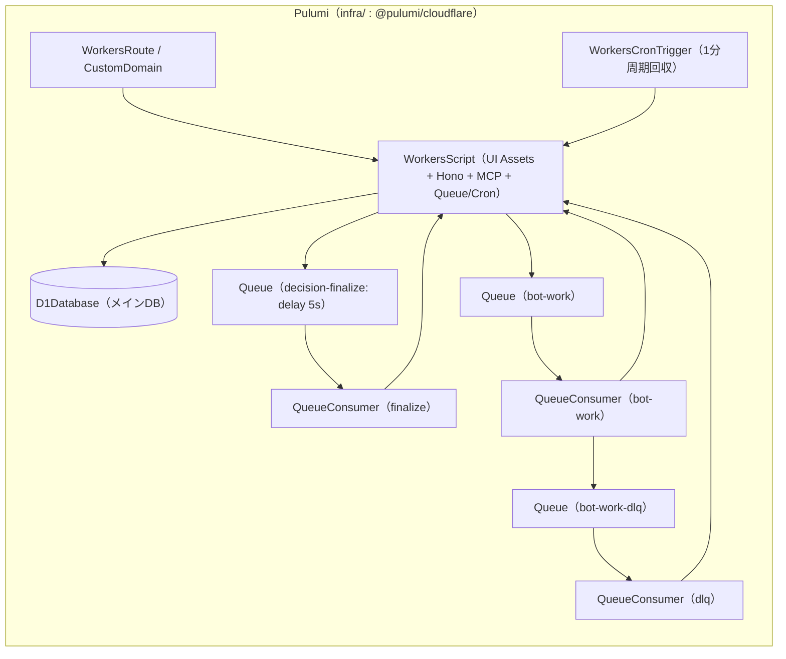
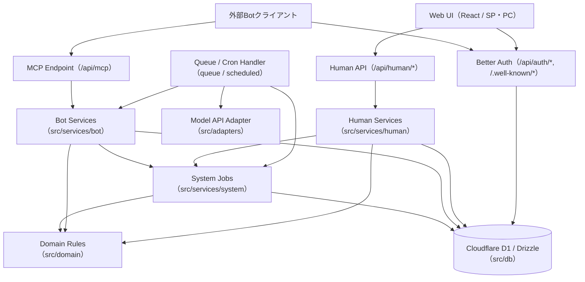

# システム構成・技術スタック仕様

作成日：2026-11-18 ／ 状態：構成基準（S0 検証・CI基盤・S5 判断カードUI試作実装済 ／ バックエンド・Bot連携未実装）

## 1. 技術スタック

| 区分                    | 採用技術                                                                                                                                    | 役割・境界                                                                                                          | 状態                   |
| ----------------------- | ------------------------------------------------------------------------------------------------------------------------------------------- | ------------------------------------------------------------------------------------------------------------------- | ---------------------- |
| Runtime・ツールチェイン | **Bun** (`>=1.4.6-0`、CIは `bun@1.4.5-canary.20261119.1` 固定：`bun check` / `bun fmt` / `bun lint` / `bun test`)                           | パッケージ管理・型検査・整形・静的解析・単体/結合テストをBun組み込み機能に統一                                      | 実装済（S0）           |
| CI・機械的ガードレール  | **GitHub Actions** (`ci.yml`) + **Git Hooks** (`.githooks/pre-commit`) + `bunfig.toml` + `scripts/check-guardrails.ts` + **`main` Ruleset** | レイヤー越境遮断・型アサーション禁止・証票ブランド型・docs/強制先検査・`ci` Green 必須化を強制                      | 実装済（S0）           |
| クラウド実行基盤        | **Cloudflare Workers**（Static Assets + HTTP + Queue Consumer + Cron）                                                                      | UI配信・Human API・MCP・ワーカー処理を単一プラットフォームで実行                                                    | 未実装                 |
| IaC（構成管理）         | **Pulumi** (`@pulumi/cloudflare`, `runtime: bun`, `infra/`)                                                                                 | Workers・D1・Queues・QueueConsumer・Cron・Route をコード管理                                                        | 未実装                 |
| Web UI                  | React + Vite + Tailwind CSS（Workers Static Assets 配信）                                                                                   | SP（360/320px基準）・PC対応のSPA（判断カード画面実装済・モック接続、他画面・`/sign-in`・`/consent` は `S4`/`S6`）   | 一部実装済（S5）       |
| HTTP API / ルーター     | **Hono**                                                                                                                                    | `/api/*`・`/.well-known/*` ルーティング、CSRF・認可ミドルウェア                                                     | 未実装                 |
| MCP Server              | `@modelcontextprotocol/server`（MCP TypeScript SDK v2・Stateless Streamable HTTP）                                                          | `/api/mcp` でBot向け12ツールを公開                                                                                  | 未実装                 |
| 入力検証                | `Zod`                                                                                                                                       | Human API と MCP JSON Schema の型・制約を共通化                                                                     | 未実装                 |
| DB / ORM                | **Cloudflare D1**（SQLite互換）+ **Drizzle ORM**（`bun test` 時は `bun:sqlite`）                                                            | 条件付き原子更新・ガード付き `db.batch`・楽観ロック・冪等キー永続化                                                 | 未実装                 |
| 非同期・5秒確定・Worker | **Cloudflare Queues**（`decision-finalize` / `bot-work` / `bot-work-dlq`）+ **Cron Triggers**                                               | 5秒仮確定の満了処理、判断確定イベントからの有界ステップ実行、期限切れ回収                                           | 未実装                 |
| 認証・認可              | **Better Auth** (`better-auth` + Drizzle Adapter + `jwt` + `@better-auth/mcp`)                                                              | Human: `/api/auth/*` セッション認証 Bot: OAuth 2.1（`/.well-known/*` 公開）＋ `BotConnection` D1リアルタイム照合 | 証票型のみ実装済（S0） |
| UI E2E検証              | Playwright（`bunx playwright test`）                                                                                                        | UI変更時のSP 360px/320px・PC代替操作・誤スワイプ防止検証                                                            | 実装済（S5：CI稼働中） |

- 禁止：Bun外のフォーマッター・リンター・単体テストランナー（Prettier / ESLint / Biome / Vitest 等）を追加導入すること（強制: `tests/guardrails/repo-guardrails.test.ts`）
- 禁止：Cloudflareリソースを手動変更のみで運用すること（`infra/` の Pulumi 定義を正とする）（強制: `S1予定`）
- 禁止：未実証のBot接続経路やデプロイ環境を「対応済」と記載すること（強制: `scripts/check-guardrails.ts`）

---

## 2. Cloudflare・Pulumi インフラ構成

| Pulumi リソース                                                                       | 役割・必須設定                                                                                                                                                         |
| ------------------------------------------------------------------------------------- | ---------------------------------------------------------------------------------------------------------------------------------------------------------------------- |
| `cloudflare.WorkersScript`（または `Worker` + `WorkerVersion` + `WorkersDeployment`） | Static Assets（`notFoundHandling: "single-page-application"`, `runWorkerFirst: ["/api/*", "/.well-known/*"]`）、`fetch` / `queue` / `scheduled`、`limits.cpuMs` を構成 |
| `cloudflare.WorkersRoute` / `WorkersCustomDomain`                                     | HTTPS エンドポイント公開（公式MCPクライアント接続・OAuth発見用）                                                                                                       |
| `cloudflare.D1Database`                                                               | Better Auth（`jwks`・OAuth含む）およびドメイン全テーブルを永続化                                                                                                       |
| `cloudflare.Queue` × 3                                                                | ① `decision-finalize`（`delaySeconds: 5`）、② `bot-work`（再開ジョブ）、③ `bot-work-dlq`（再試行上限超過の退避先）                                                     |
| `cloudflare.QueueConsumer` × 3                                                        | `decision-finalize`・`bot-work`・`bot-work-dlq` ごとに `batchSize`・`maxRetries`・`deadLetterQueue` を分離して Worker へ接続                                           |
| `cloudflare.WorkersCronTrigger`                                                       | 1分周期で未処理の期限切れ `provisional`・`work_leases`・`decision_cards` 回収と、未消費 `decisions(consumed_at IS NULL)` 再配送を実行                                  |

---

## 3. アプリケーションレイヤー境界

- 禁止：Better Auth インスタンスや Drizzle(D1) クライアントをモジュールスコープのシングルトンにすること（リクエスト毎に `env.DB` と `ctx.waitUntil` を渡して生成する）（強制: `tests/guardrails/repo-guardrails.test.ts`）
- 禁止：`/api/mcp` でローカルJWT検証のみを通し D1 の `bot_connections` 照合を省略すること（即時失効・一時停止・スコープ縮小を毎リクエスト強制する、`BOT-02`）（強制: `src/auth/bot.ts`, `tests/guardrails/auth-and-boundaries.test.ts`, `S2予定`）
- 禁止：UI・ルーター・MCPハンドラから `src/db/` を直接参照・更新すること（強制: `bunfig.toml`）
- 禁止：`MCP` ハンドラおよび `Queue / Cron Handler` から `src/services/human/`（採用・見送り・取消・保留・権限変更）を呼ぶこと（`BOT-02`）（強制: `bunfig.toml`）
- 禁止：モデルAPI秘密鍵・`BETTER_AUTH_SECRET`・接続トークン平文をクライアントバンドル・カード本文・ログ・Gitへ出力すること（強制: `bunfig.toml`, `src/shared/logger.ts`, `.gitignore`）

---

## 4. ディレクトリ構成

| パス                   | 責務                                                                                                                                        | 境界ガードレール                                                                                                          |
| ---------------------- | ------------------------------------------------------------------------------------------------------------------------------------------- | ------------------------------------------------------------------------------------------------------------------------- |
| `src/client/`          | React + Tailwind CSS による判断カードUI（`api/` ポート・モック実装＋`components/`、他3画面・`/sign-in`・`/consent` は `S4`/`S6`）           | ドメイン遷移判定の重複実装禁止・`Bun` グローバル参照禁止                                                                  |
| `src/server/routes/`   | Hono ルーター（`/api/auth/*`, `/.well-known/*`, `/api/human/*`, `/api/mcp`）                                                                | `/api/human/*` 更新系に `trustedOrigins` ベースのCSRF検証を必須化。`src/db` 直接参照禁止                                  |
| `src/auth/`            | 証票ブランド型（`context.ts`）、発行隔離（`internal/`）、主体別検証入口（Human専用 `owner.ts` / Bot専用 `bot.ts`）、および Better Auth 設定 | `owner.ts` は Human Route のみ、`bot.ts` は MCP Route・Worker のみ import 許可（`bun lint` で強制）                       |
| `src/domain/`          | `selection_mode` ペイロード検証・スワイプ軸分離/閾値ルール（`S5` 実装済）、`Task` / `DecisionCard` 状態遷移・版検証（`S1`）                 | 外部I/O・DB・他層・DOM/`Bun` グローバルへの依存全面禁止（`bun lint` で強制）                                              |
| `src/services/human/`  | 仮確定＋5秒遅延Queue投入、5秒取消、保留、タスク再試行、状況/履歴取得、接続管理                                                              | `OwnerContext` 必須・Bot/System/Adapter/Worker/MCPからのimport禁止（`bun lint` で強制）                                   |
| `src/services/bot/`    | タスク・成果操作、占有取得・延長、提案一括登録・差替、確定判断取得、結果記録                                                                | `VerifiedBotContext`（D1照合・`oauth_client_id` 一致済）・`workspace_id`・`scopes`・`expected_version`・`request_id` 必須 |
| `src/services/system/` | 5秒猶予満了の確定処理（Queue・Cron・読取時オンデマンド共通）、期限切れ整理、DLQ失敗遷移                                                     | 冪等設計必須・`services/human` 参照禁止                                                                                   |
| `src/adapters/`        | 外部モデルAPI呼び出し（1起動＝1有界ステップ）、タイムアウト・費用上限ガード                                                                 | `AbortSignal.timeout` ＜ `WorkLease` 有効期限を厳守し、DB・Service への直接依存禁止                                       |
| `src/db/`              | Drizzle スキーマ（Better Auth + ドメイン）、マイグレーション、条件ガード付き `db.batch` ヘルパー                                            | `src/db/` 外での Drizzle SQLite/D1 生成禁止・先行 `UPDATE` 0件一致時の後続SQL抑止ガード必須                               |
| `src/worker/`          | Cloudflare Worker エントリ（`fetch`, `queue`, `scheduled`）、キュー名分岐とメッセージ単位 `ack()/retry()`                                   | 無限再提案ループ禁止・DLQ到達時はTaskを `failed`（理由付）へ遷移（`BOT-03`）                                              |
| `src/shared/`          | マスク処理済み構造化ロガー（`src/shared/logger.ts`）                                                                                        | `no-console` 唯一許可箇所（秘密鍵・PEM・`Bearer`・循環参照・`Error` の安全な直列化必須）                                  |
| `scripts/`             | `docs/` 規約・強制先タグ・相対リンク・Mermaid 構文の決定論的検査（`check-guardrails.ts`）                                                   | ネットワーク通信・`src/` との相互参照禁止（`bun lint` で強制）                                                            |
| `infra/`               | Pulumi（`Pulumi.yaml`, `index.ts`）による Cloudflare リソース定義                                                                           | 手動変更禁止・シークレットは暗号化管理                                                                                    |
| `tests/`               | `guardrails/`（構造・境界・docs検査）、`unit/`（`bun:test`）、`integration/`（`bun:test` + `bun:sqlite`）、`e2e/`（Playwright）             | [企画・要件書](concept.md) の AC ID およびレイヤー境界と対応付け                                                          |

---

## 5. 自動検証コマンドと機械的ガードレール（Subagent / CI Gate 基準）

| コマンド                   | 実行内容                                                                                                                               | PR合格基準                  | 状態                          |
| -------------------------- | -------------------------------------------------------------------------------------------------------------------------------------- | --------------------------- | ----------------------------- |
| `bun fmt --check`          | `bunfig.toml` `[fmt]`（`sortImports`, `sortPackageJson`）に基づく整形検査                                                              | 差分 0                      | 稼働中（CI + `main` Ruleset） |
| `bun lint`                 | `bunfig.toml` `[lint]`（`typeAware = true`, `maxWarnings = 0`, 全層DAG越境遮断, `as`・`src/`内 `@ts-expect-error`・`no-console` 禁止） | エラー・警告 0              | 稼働中（CI + `main` Ruleset） |
| `bun check`                | `tsconfig.json`（TS7 strict群 + Unique Symbol 証票ブランド型）による全層型検査                                                         | エラー 0                    | 稼働中（CI + `main` Ruleset） |
| `bun run check:guardrails` | `scripts/check-guardrails.ts`（`禁止：` 強制先タグ実在・相対リンク・Mermaid構文・経緯見出し・未実証 `対応済` 検査）                    | エラー 0                    | 稼働中（CI + `main` Ruleset） |
| `bun test`                 | `tests/guardrails/`（禁止依存・シングルトン不在・Lint境界実働検証・docs/証票/ロガー検査）および単体/結合テスト                         | 全件 Pass                   | 稼働中（CI + `main` Ruleset） |
| `bun run build`            | `vite build` による Web UI プロダクションバンドル検証（`dist/client/`）                                                                | エラー 0                    | 稼働中（CI + `main` Ruleset） |
| `bun run test:e2e`         | `bunx playwright test`（SP 360px/320px・PCボタン/キーボード・2択/単一複数択/複数チェック・5秒取消・誤スワイプ防止）                    | 全件 Pass                   | 稼働中（CI + `main` Ruleset） |
| `bun run infra:preview`    | `pulumi preview` による Cloudflare 構成差分の検証                                                                                      | エラー 0（`infra/` 変更時） | `S1` で追加                   |

- 禁止：型アサーション（`as`）や `src/` 内の `@ts-expect-error` を用いて型検査・証票型をバイパスすること（`consistent-type-assertions = "never"`・`ban-ts-comment` で遮断）（強制: `bunfig.toml`）
- 禁止：不要な `eslint-disable` コメントを残すこと（`reportUnusedDisableDirectives = "error"` で遮断）（強制: `bunfig.toml`）
