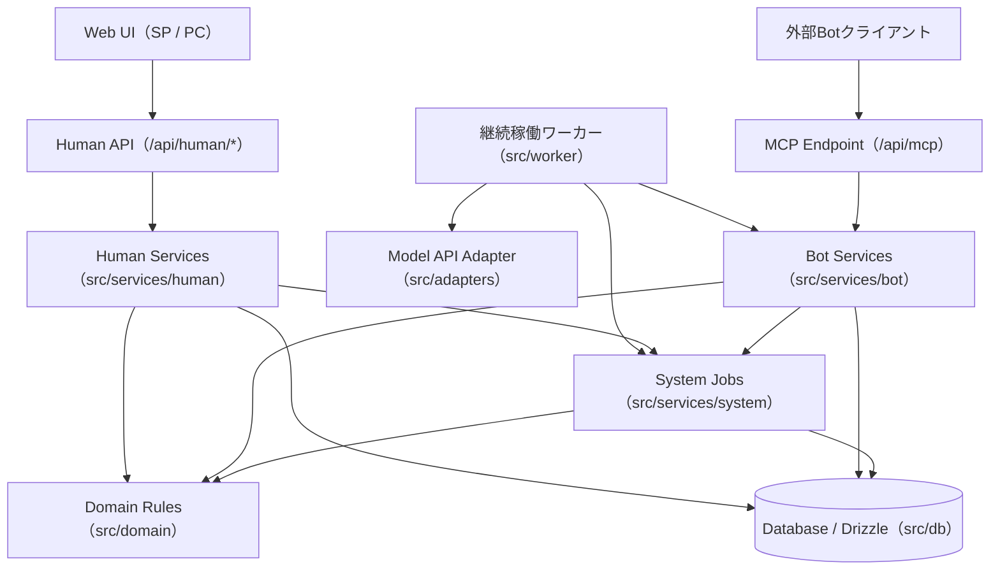

# システム構成・技術スタック仕様

作成日：2026-11-18 ／ 状態：構成基準（未実装）

## 1. 技術スタック（MVP基準）

| 区分 | 採用技術 | 役割・境界 | 状態 |
| --- | --- | --- | --- |
| 言語・Runtime | TypeScript (`strict`) / Node.js 24 LTS | UI・API・MCP・Worker の単一言語統一 | 未実装 |
| パッケージ管理 | `pnpm` | 単一リポジトリ管理 | 未実装 |
| Web UI / BFF | Next.js (App Router) + React + Tailwind CSS | SP（360/320px基準）・PC画面、Human専用API | 未実装 |
| MCP Server | `@modelcontextprotocol/sdk` (Streamable HTTP) | `/api/mcp` でBot向け12ツールを公開 | 未実装 |
| 入力検証 | `Zod` | Human API と MCP JSON Schema の型・制約を共通化 | 未実装 |
| DB / ORM | SQLite（`libSQL`：ローカルファイル / Turso対応）+ `Drizzle ORM` | 排他トランザクション・楽観ロック・冪等キー永続化 | 未実装 |
| System Jobs | 冪等内部ジョブ (`src/services/system`) | 5秒仮確定の満了確定・期限切れ占有/カード整理（APIプロセス内タイマー・読取時オンデマンド・Workerから共通実行） | 未実装 |
| Worker | Node.js 常駐プロセス (`src/worker`) | 確定判断・`ready` タスクの定期取得、モデルAPI実行、自動再開 | 未実装 |
| 認証 | Human: `sessions` テーブル + `HttpOnly; SameSite=Lax` Cookie + `Origin` CSRF検証（初期オーナーは環境変数設定） Bot: `BotConnection` 別 Bearer Token（公式チャット接続時はOAuth対応を検証） | 人とBotの認証主体を完全分離（`BOT-02`） | 未実装 |
| 自動検証 | `tsc` / `Biome` / `Vitest` / `Playwright` | 型・Lint・単体/競合テスト・SP/PC E2E | 未実装 |

- 禁止：モデルの会話履歴をタスク・判断状態の正とすること（常にDBを正とする）
- 禁止：未実証のBot接続経路やクラウド基盤を「対応済」と記載すること

---

## 2. レイヤー構成と依存境界

- 禁止：`src/app/`・`src/components/`・`MCP` ハンドラから `src/db/` を直接参照・更新すること
- 禁止：`MCP` ハンドラおよび `src/worker/` から `src/services/human/`（採用・見送り・取消・保留・権限変更）を呼ぶこと（`BOT-02`）
- 禁止：モデルAPI秘密鍵・接続トークン平文をクライアントバンドル・カード本文・通常ログへ出力すること

---

## 3. ディレクトリ構成

| パス | 責務 | 境界ガードレール |
| --- | --- | --- |
| `src/app/` | 4画面（判断・状況・履歴・設定）と Route Handlers（`/api/human/*`, `/api/mcp`） | 認証/CSRF検証と入出力変換のみ。業務ロジック保持禁止 |
| `src/components/` | 判断カード、詳細・候補比較、横スワイプ制御、5秒取消バー、各状態UI | API直接変更・ドメイン判定の重複実装禁止 |
| `src/domain/` | `Task` / `DecisionCard` 状態遷移判定、版・期限チェック、エラーコード定義 | 外部I/O・DB・フレームワーク依存禁止 |
| `src/services/human/` | 所有者認証、仮確定、5秒取消、保留、タスク再試行、状況/履歴取得、接続管理 | 所有者セッション必須・Botからの呼び出し禁止 |
| `src/services/bot/` | タスク操作、占有取得・延長、提案一括登録・差替、確定判断取得、結果記録 | `workspace_id`・`scopes`・`expected_version`・`request_id` 必須 |
| `src/services/system/` | 5秒猶予満了の確定トランザクション、期限切れ占有・カードの整理 | 冪等設計必須（Worker未稼働時もAPI側から実行可能にする） |
| `src/adapters/` | 外部モデルAPI呼び出し、タイムアウト・トークン/費用上限ガード | 必要最小限のタスク情報のみ送信 |
| `src/db/` | Drizzle スキーマ、マイグレーション、排他トランザクション | `src/services/*` からのみ利用 |
| `src/worker/` | ポーリングループ、判断確定イベント消化、再起動時のDB再開 | 無限再提案ループ禁止（回数・費用上限必須） |
| `tests/` | `unit/`（domain）、`integration/`（競合・5秒取消・認可）、`e2e/`（SP/PC） | [企画・要件書](concept.md) の AC ID と対応付け |

---

## 4. 自動検証コマンド（Subagent Gate 基準）

| コマンド | 実行内容 | PR合格基準 |
| --- | --- | --- |
| `pnpm typecheck` | `tsc --noEmit` による全層の型検査 | エラー 0 |
| `pnpm lint` | `biome check` による静的解析・フォーマット検査 | エラー 0 |
| `pnpm test` | `vitest run`（状態遷移・版競合・5秒取消排他・認可境界） | 全件 Pass |
| `pnpm test:e2e` | `playwright test`（SP 360px/320px・PCボタン/キーボード・誤スワイプ防止） | UI変更時は全件 Pass |
