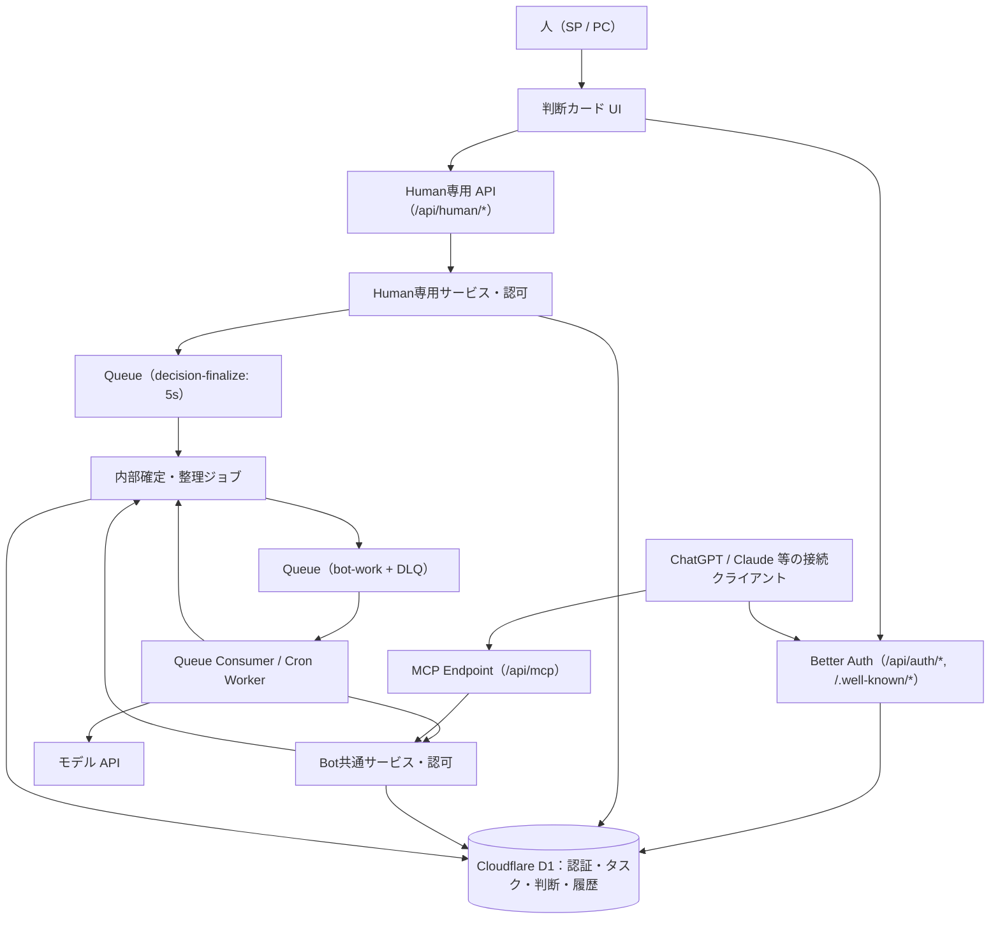

# Bot連携・状態設計

作成日：2026-11-18 ／ 状態：設計基準（未実装）

[企画・要件書](concept.md)の「Botが管理し、人はスワイプで選択する」を実現するための構成。仕様名・操作名は本アプリの提案であり、各社製品の既存API名ではない。

## 1. 接続方針と確認できた事実

共通の業務処理をHTTP APIとMCPから呼べるようにする。MCPはBotへ操作の名前・引数・結果を伝える接続方式。Botごとに別のタスク管理機能を作らず、権限と状態遷移を共通化する。

| 対象    | 公式情報で確認した範囲                                       | 本アプリでの連携案・未確認事項                                                  |
| ------- | ------------------------------------------------------------ | ------------------------------------------------------------------------------- |
| ChatGPT | HTTPS上の独自MCPサーバーを接続し、ツールを使う公式手順がある | MCPでタスクとカードを操作。対象アカウント・SP/PCでの設定と利用を実機確認する    |
| Claude  | remote MCPのカスタムコネクターがある。接続元はクラウド側     | 同じMCPを利用。認証とSP/PCでの往復操作を実機確認する                            |
| Grok    | xAI APIのremote MCP toolsで外部MCPを指定できる               | APIワーカー経由を候補とする。一般向けGrokアプリからの直接接続は本調査では未確認 |
| Muse    | 正式なサービスを特定できていない                             | 名称・URLを確認してからMCP、HTTP API等の対応を調べる。対応可能とは断定しない    |

根拠：[OpenAIのMCP接続手順](https://developers.openai.com/plugins/build/app-quickstart)、[Claudeのremote MCP案内](https://support.claude.com/en/articles/11175166-get-started-with-custom-connectors-using-remote-mcp)、[xAIのremote MCP tools](https://docs.x.ai/developers/tools/remote-mcp)。2026-11-18に参照。上表は文書上の機能確認であり、このアプリとの接続成功を意味しない。

### 「接続できる」と「自動で動き続ける」を区別する

- 公式チャット経由：ユーザーがそのサービスで会話を実行しているときに、Botがタスクを操作する経路。判断後の自動再開は別途検証が必要。
- APIワーカー経由：サーバー側のワーカーが仕事・判断結果を取得し、モデルAPIとツールを呼んで作業する経路。アプリを閉じても継続できる設計にする。
- 対応するモデルAPIを利用できても、それをChatGPTやClaudeの公式アプリ接続成功とは数えない。

人が毎回Botへ「続けて」と入力しなくてよい体験には後者の仕組みが必要となる、というのが本設計の判断。API利用条件と費用は接続実証の際に確認する。対象Botすべての自律実行を一括で保証しない。

## 2. 構成案

- 基盤構成：Cloudflare（Workers / D1 / Queues / Cron）＋ Pulumi（`infra/`）。詳細は[システム構成・技術スタック仕様](architecture.md)を参照。
- 禁止：モデルの会話履歴を状態の正とすること（常に Cloudflare D1 を正とする）（強制: `S2予定`）

## 3. データと状態

エンティティ構成、DBテーブル制約、`Task` / `DecisionCard` の状態遷移図、5秒取消・候補グループ排他制御は[データモデル・状態遷移・排他制御仕様](data-and-state.md)を参照。

## 4. 公開インターフェース（Bot MCP / Human API）

### Bot向けMCPツール（`/api/mcp`：全12ツール）

| ツール名                | 必要スコープ      | 用途・主要入力                                                                                                                                              |
| ----------------------- | ----------------- | ----------------------------------------------------------------------------------------------------------------------------------------------------------- |
| `get_workspace_context` | `tasks:read`      | 目的、許可範囲、停止状態、状態の意味を取得                                                                                                                  |
| `list_tasks`            | `tasks:read`      | 状態・担当等でカーソル検索し概要一覧を取得                                                                                                                  |
| `get_task`              | `tasks:read`      | 指定タスクの詳細・最新 `version`・関連成果概要を取得                                                                                                        |
| `get_artifact`          | `tasks:read`      | 指定 `artifact_id`（および版）の長文本文またはURLを別取得                                                                                                   |
| `create_task`           | `tasks:write`     | タイトル、説明、親タスク、`requires_approval` を指定して作成                                                                                                |
| `claim_task`            | `tasks:write`     | 作業権（`lease_token`）を期限付き取得。別Bot占有中・一時停止中は取得不可                                                                                    |
| `renew_lease`           | `tasks:write`     | 保有中 `lease_token` の有効期限を延長                                                                                                                       |
| `update_task`           | `tasks:write`     | 担当作業の説明・`blocked` 理由・`artifacts`（新規作成または版更新）を保存。`expected_version`・`lease_token` 検証                                           |
| `submit_proposal`       | `proposals:write` | 単一または同一 `selection_group_id` の候補配列（`1..N`件、対象 `artifacts` の同時Upsert可）を一括登録し `waiting_human` へ遷移・占有解放                    |
| `supersede_proposal`    | `proposals:write` | `waiting_human`（または `running`）の未確定カードを `superseded` にし、後継カード（および更新 `artifacts`）を原子的に登録（`provisional` 中は拒否）         |
| `list_decision_results` | `decisions:read`  | 確定済みの判断（`status = 'finalized'` のみ）をカーソル取得                                                                                                 |
| `record_result`         | `tasks:write`     | 実行結果・`artifacts`（作成/版更新）・失敗理由を保存。`decision_id` 指定時は `consumed_at` を記録し、`requires_approval = false` の成功時のみ `done` へ遷移 |

### 認証・Human専用API（`/api/auth/*`, `/.well-known/*`, `/api/human/*`）

| エンドポイント                                                                 | 用途                                                                                                                                              | 必須検証                                                                                                                                      |
| ------------------------------------------------------------------------------ | ------------------------------------------------------------------------------------------------------------------------------------------------- | --------------------------------------------------------------------------------------------------------------------------------------------- |
| `/api/auth/*`, `/.well-known/*`                                                | Better Auth 所有者認証、公式MCP向け OAuth 2.1 発見・認可・トークン発行（同意完了時に `bot_connections` をUpsert）                                 | Better Auth 組み込み CSRF / `trustedOrigins`、初期オーナー以外の登録拒否                                                                      |
| `GET /api/human/cards`                                                         | 判断待ちカード一覧（`pending` / `deferred` フィルタ、自分の `provisional` を含む。同グループで別案 `provisional(accepted)` 中の残候補は一時除外） | Better Auth 所有者セッション                                                                                                                  |
| `GET /api/human/cards/:id`                                                     | カード詳細、対象 `Artifact` プレビュー、同グループ候補比較、復帰時の最新状態取得                                                                  | Better Auth 所有者セッション                                                                                                                  |
| `POST /api/human/cards/:id/decide`                                             | 採用／見送りの仮確定（`pending → provisional`、`decision-finalize` Queueへ5秒遅延投入）                                                           | 所有者セッション、Hono `trustedOrigins` CSRF、`expected_version`、`request_id`、`expires_at > now`、対象Task/Artifact版、候補グループ未ロック |
| `POST /api/human/cards/:id/undo`                                               | 5秒以内の取り消し（`provisional → pending`）                                                                                                      | 所有者セッション、Hono CSRF、`expected_version`、`request_id`、`now < provisional_until` 排他検証（`DEC-01`）                                 |
| `POST /api/human/cards/:id/defer`                                              | 保留・復帰（`pending ⇄ deferred` のみ許可。同グループ `provisional(accepted)` 中は拒否）                                                          | 所有者セッション、Hono CSRF、`expected_version`、`request_id`                                                                                 |
| `GET /api/human/board`                                                         | 状況画面：Bot進行状況・待機/失敗理由・読み取り専用カンバン取得                                                                                    | 所有者セッション（列移動・タスク直接編集APIは非提供、`UX-01`）                                                                                |
| `POST /api/human/tasks/:id/retry`                                              | `failed / blocked → ready` の再開・再試行指示                                                                                                     | 所有者セッション、Hono CSRF、`expected_version`、`request_id`                                                                                 |
| `GET /api/human/history`                                                       | 履歴画面：確定済みの採用・見送り・成果・イベント一覧                                                                                              | 所有者セッション、カーソルページング                                                                                                          |
| `GET /api/human/workspace` `PATCH /api/human/workspace`                     | 初回設定・目的・許可範囲・上限・緊急一時停止（`is_paused`）の取得・更新                                                                           | 更新時は所有者セッション、Hono CSRF、`expected_version`、`request_id`                                                                         |
| `GET /api/human/bots` `POST /api/human/bots` `PATCH /api/human/bots/:id` | Bot接続一覧・Worker Bearer発行・`scopes` 変更・一時停止（`paused`）・失効（`revoked`）                                                            | 更新時は所有者セッション、Hono CSRF、`expected_version`、`request_id`                                                                         |

### 停止・失効・スコープ境界（毎リクエストD1強制）

| 状態 / 設定                          | サーバー制御（結論）                                                                                                                                                                                                                | エラーコード       |
| ------------------------------------ | ----------------------------------------------------------------------------------------------------------------------------------------------------------------------------------------------------------------------------------- | ------------------ |
| `/api/mcp` 認証照合                  | OAuth JWT（`sub == owner_user_id` かつ `oauth_client_id` 一致）と Worker Bearer（`token_hash` 一致）の双方で**毎リクエストD1の `bot_connections` を引き**、`status` と実効スコープ（`token.scopes ∩ bot_connections.scopes`）を強制 | `NOT_AUTHORIZED`   |
| `workspaces.is_paused = true`        | 全Botの新規占有・書込（`create_task` / `claim_task` / `update_task` / `submit_proposal` 等）を拒否し、Queue Workerの新規実行を停止                                                                                                  | `WORKSPACE_PAUSED` |
| `bot_connections.status = 'paused'`  | 当該Botの新規占有・書込操作を拒否（読取のみ許可）                                                                                                                                                                                   | `NOT_AUTHORIZED`   |
| `bot_connections.status = 'revoked'` | 同一 `db.batch` で保有中 `work_leases` と該当 `oauth_client_id` のOAuthトークン/同意を失効させ、以後の全読書きを即時拒否                                                                                                            | `NOT_AUTHORIZED`   |
| `bot_connections.scopes` 不足        | 実効スコープがツールの必要スコープを満たさない呼び出しを拒否                                                                                                                                                                        | `NOT_AUTHORIZED`   |

- 禁止：Bot向けMCPに承認・取消・保留・タスク強制再開・権限付与操作を公開すること（`BOT-02`）（強制: `bunfig.toml`, `S2予定`）
- 仕様規則：各MCPツールはJSON Schemaで必須引数・列挙値を定義し短い概要を返す。一覧はページングし長文成果は `get_artifact` で別取得にする。曖昧な一致は候補を返し推測更新しない。

### 共通の更新規則

- 作成・更新に`request_id`を要求。同じ認証主体・操作・`request_id`・入力は同じ結果を返す。入力が異なる再利用は `IDEMPOTENCY_CONFLICT` で拒否する。
- 更新には`expected_version`を要求し、競合時は `VERSION_CONFLICT` で再取得を促す。無条件の後勝ち上書きをしない。
- 操作元Botは認証情報から決める。Botが送った表示名を本人確認に使わない。
- 成功時は対象ID、保存後のversion、状態、追跡用IDを返す。エラーは`code`、`message`、`retryable`を返す。
- エラーコード：`VALIDATION_ERROR`、`NOT_AUTHORIZED`、`NOT_FOUND`、`IDEMPOTENCY_CONFLICT`、`VERSION_CONFLICT`、`LEASE_CONFLICT`、`GROUP_LOCKED`、`INVALID_TRANSITION`、`STALE_PROPOSAL`、`WORKSPACE_PAUSED`、`RATE_LIMITED`。

## 5. 人の判断と実行の結合

1. Botが採用時に行う操作、対象ID・版、説明をProposalに固定する。
2. 人が右へスワイプすると、サーバーが権限・有効期限・対象版を確認して仮確定し、`meta.changes === 1` 確認後に `decision-finalize` Queue（`delaySeconds: 5`）へ投入する。
3. 取り消し猶予の終了後、D1上で原子的に判断を確定（`status = 'finalized'`）し、`bot-work` Queue へ配送する（Queue投入失敗時も Cron Trigger が未消費の `consumed_at IS NULL` を回収して再配送する）。
4. キュー配送は再送されてもよい。ワーカーは`decision_id`（`consumed_at`）と `WorkLease` を使って二重処理を防ぐ。
5. 実行直前にも対象版（`finalized_task_version`）・権限・提案内容を検証する。変わっていれば古い承認を流用せず、新しい再確認カードを作成する。
6. Botが結果を記録し、必要に応じて次のカードを作成する。

判断の採用と処理の成功は別々に記録する。失敗は採用済みのまま「実行失敗」と表示する。再試行しても同じ処理が重複しないようにし、不明な外部結果を成功や失敗と決めつけない。

MVPの処理対象はタスク管理・調査・下書き・成果登録。将来の外部公開・送信・課金では、サービス側の冪等性や実行結果確認も含めた追加設計を行う。

## 6. ワーカーの責務

- Cloudflare Queues（`bot-work`）で起動し、`queue()` 内でキュー名を分岐してメッセージ単位に `ack()` / `retry({ delaySeconds })` を制御する。未消費判断・`ready` タスク・期限切れ占有の回収は Cron Trigger で補完する。
- 1回の Queue 実行は「1有界ステップのモデルAPI呼び出し＋D1チェックポイント保存」に限定し、モデルAPIタイムアウトを `WorkLease` 有効期限未満に設定する。
- タスクを期限付きで占有し、人の判断待ちでは占有を解除して長時間のモデル呼び出しを維持しない。
- 再実行・障害復帰時はD1の状態から再開し、無条件に最初から重複実行しない。
- 回数・時間・費用上限、手動停止（`is_paused`）を設け、再試行上限超過（`bot-work-dlq` 到達）時はタスクを `failed`（理由記録、`BOT-03`）へ遷移させる。
- 複数Botの役割は固定しない。まず1つの実行経路を通し、担当取得の仕組みを使って追加する。

## 7. 認証・データ境界

- 主体分離：Human は Better Auth セッション、公式MCP Bot は `@better-auth/mcp`（OAuth 2.1）＋ `bot_connections` D1照合、Worker は限定スコープの `BotConnection` Bearer Token とする。
- 境界強制：全読み書きで認証由来の `workspace_id` と `bot_connections.status`・`scopes` をサーバー側検証する。
- 秘密保護：モデルAPI秘密鍵・認証シークレット・トークン平文をクライアント・カード本文・ログへ出力せず、外部モデルには必要最小限のタスク情報のみ渡す。
- 権限不拡大：タスク本文・成果・外部リンク内の命令による権限拡大を認めず、実行可能な操作・対象・承認状態をサーバーで制限する。

## 8. 接続実証と完了基準

| 経路                    | 実証項目                                                        | 現在   |
| ----------------------- | --------------------------------------------------------------- | ------ |
| ChatGPT公式クライアント | 認証→検索→タスク作成→カード提出→確定結果取得。SP/PCの可否を記録 | 未実施 |
| Claude公式クライアント  | 同上。接続元からサーバーへ到達できることも確認                  | 未実施 |
| Grok APIワーカー        | 同上に加え、人の判断後に追加チャット入力なしで再開              | 未実施 |
| Muse                    | サービス特定→連携方式の確認→同じ操作契約を検証                  | 未特定 |

共通で、認証失効、別ワークスペースへのアクセス拒否、二重要求、同時採用、取り消しとの競合、期限切れ、実行中クラッシュを検証する。公式チャット、APIワーカー、SP、PCの結果を分けて記録し、未確認の経路を対応済みにしない。
