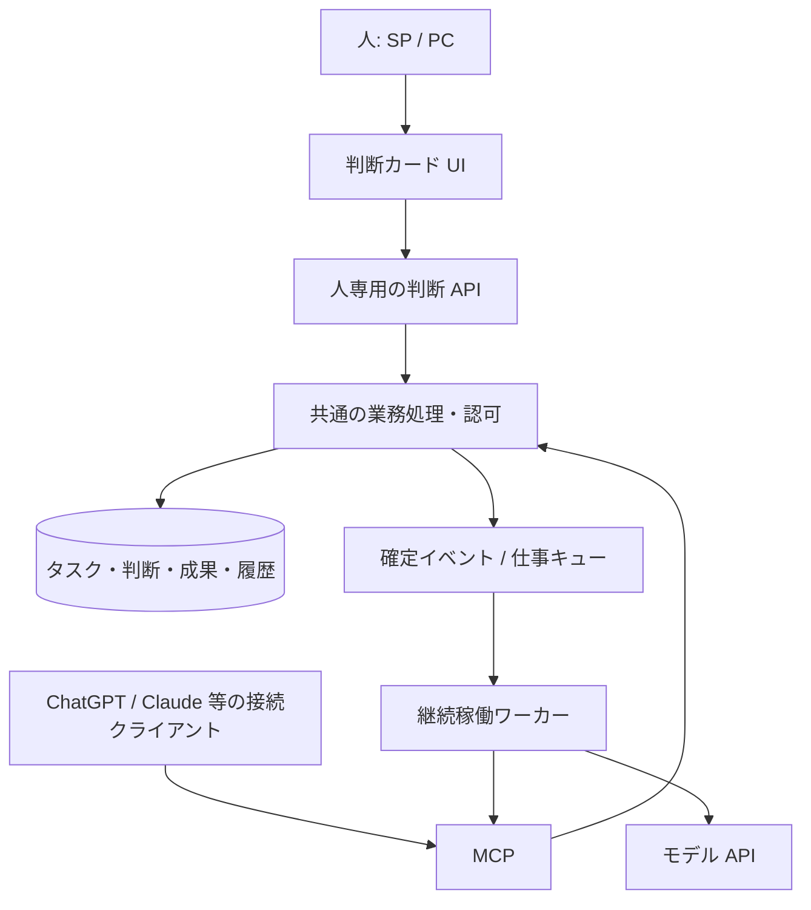

# Bot連携・状態設計

作成日：2026-11-18 ／ 状態：設計提案・未実装

[企画・要件書](concept.md)の「Botが管理し、人はスワイプで選択する」を実現するための構成。仕様名・操作名は本アプリの提案であり、各社製品の既存API名ではない。

## 1. 接続方針と確認できた事実

共通の業務処理をHTTP APIとMCPから呼べるようにする。MCPはBotへ操作の名前・引数・結果を伝える接続方式。Botごとに別のタスク管理機能を作らず、権限と状態遷移を共通化する。

| 対象 | 公式情報で確認した範囲 | 本アプリでの連携案・未確認事項 |
| --- | --- | --- |
| ChatGPT | HTTPS上の独自MCPサーバーを接続し、ツールを使う公式手順がある | MCPでタスクとカードを操作。対象アカウント・SP/PCでの設定と利用を実機確認する |
| Claude | remote MCPのカスタムコネクターがある。接続元はクラウド側 | 同じMCPを利用。認証とSP/PCでの往復操作を実機確認する |
| Grok | xAI APIのremote MCP toolsで外部MCPを指定できる | APIワーカー経由を候補とする。一般向けGrokアプリからの直接接続は本調査では未確認 |
| Muse | 正式なサービスを特定できていない | 名称・URLを確認してからMCP、HTTP API等の対応を調べる。対応可能とは断定しない |

根拠：[OpenAIのMCP接続手順](https://developers.openai.com/plugins/build/app-quickstart)、[Claudeのremote MCP案内](https://support.claude.com/en/articles/11175166-get-started-with-custom-connectors-using-remote-mcp)、[xAIのremote MCP tools](https://docs.x.ai/developers/tools/remote-mcp)。2026-11-18に参照。上表は文書上の機能確認であり、このアプリとの接続成功を意味しない。

### 「接続できる」と「自動で動き続ける」を区別する

- 公式チャット経由：ユーザーがそのサービスで会話を実行しているときに、Botがタスクを操作する経路。判断後の自動再開は別途検証が必要。
- APIワーカー経由：サーバー側のワーカーが仕事・判断結果を取得し、モデルAPIとツールを呼んで作業する経路。アプリを閉じても継続できる設計にする。
- 対応するモデルAPIを利用できても、それをChatGPTやClaudeの公式アプリ接続成功とは数えない。

人が毎回Botへ「続けて」と入力しなくてよい体験には後者の仕組みが必要となる、というのが本設計の判断。API利用条件と費用は接続実証の際に確認する。対象Botすべての自律実行を一括で保証しない。

## 2. 構成案

実装は1つのバックエンドから始めてもよい。UI・MCP・ワーカーで同じ更新規則を共有する。DBを正とし、モデルの会話履歴を進捗の唯一の保存先にしない。フレームワーク・DB製品・ホスティングは未選定。

## 3. データと状態

| エンティティ | 主な内容 |
| --- | --- |
| Workspace | 所有者、目的、Botに任せる範囲、実行上限 |
| BotConnection | 表示名、接続方式、認証主体、権限、稼働状態 |
| Task | ID、目的、説明、状態、担当、成果参照、version |
| WorkLease | task_id、bot_id、期限、lease_token。重複着手を防ぐ占有 |
| Proposal | 提案本文、採用時の操作、見送り時の方針、対象の版、内容ハッシュ |
| DecisionCard | proposal_id、選択グループ、状態、有効期限、version |
| Decision | 人のID、結果、カードの版、仮確定時刻、確定時刻 |
| Artifact | 成果の本文またはURL、版、作成Bot |
| Event | 操作主体、対象、変更内容、request_id、時刻 |

タスク状態案：`ready → running → waiting_human → ready / done`。Botの失敗は`failed`、依存待ちは`blocked`として区別する。成果の受け入れカードの採用時だけ`done`へ進められるケースと、方針採用で`ready`に戻るケースを明示する。見送り時は再検討用の`ready`または理由付き`blocked`へ移し、自動で完了にしない。

カード状態案：`pending → provisional → accepted / declined`。保留は`deferred`、提案更新は`superseded`、期限切れは`expired`、候補グループ内の別案採用は`closed`。保留カードはユーザーが「あとで」一覧から戻すか、次回の判断セッションで再提示する。

5秒の仮確定からの取り消しは`pending`に戻す。`provisional`はまだ承認として利用できない。複数候補では仮確定時にグループをロックし、取り消しで解除、採用の確定で残りを`closed`にする。

## 4. Botへ公開する操作案

| 操作 | 用途・主要入力 |
| --- | --- |
| `get_workspace_context` | 目的、許可範囲、状態の意味を取得 |
| `list_tasks` / `get_task` | 状態・担当等で検索、必要な詳細だけ取得 |
| `create_task` | 目的、タイトル、説明を指定して作成 |
| `claim_task` / `renew_lease` | 作業権を取得・延長。別Botの占有中は取得不可 |
| `update_task` | 担当作業の状態・成果を更新。版と占有トークンを検証 |
| `submit_proposal` | 判断カードと固定された提案内容を登録 |
| `supersede_proposal` | 古い提案を無効化し、別の版として出し直す |
| `list_decision_results` | 確定済みの判断をカーソルで取得 |
| `record_result` | 実行結果・成果・失敗理由を保存 |

人の採用・見送り・取り消しは人専用の認証付きAPIで受け付ける。Bot向けMCPには承認操作・権限付与操作を公開しない。

各ツールはJSON Schemaで必須引数・列挙値・説明を定義し、短い概要を返す。一覧はページングし、長文成果は別取得にする。曖昧なタスク名が複数一致したら候補を返し、推測で別タスクを変更しない。

### 共通の更新規則

- 作成・更新に`request_id`を要求。同じ認証主体・操作・request_id・入力は同じ結果を返す。入力が異なる再利用は拒否する。
- 更新には`expected_version`を要求し、競合時は再取得を促す。無条件の後勝ち上書きをしない。
- 操作元Botは認証情報から決める。Botが送った表示名を本人確認に使わない。
- 成功時は対象ID、保存後のversion、状態、追跡用IDを返す。エラーは`code`、`message`、`retryable`を返す。
- エラー区分案：`NOT_AUTHORIZED`、`VERSION_CONFLICT`、`LEASE_CONFLICT`、`INVALID_TRANSITION`、`STALE_PROPOSAL`、`RATE_LIMITED`。

## 5. 人の判断と実行の結合

1. Botが採用時に行う操作、対象ID・版、説明をProposalに固定する。
2. 人が右へスワイプすると、サーバーが権限・有効期限・対象版を確認して仮確定する。
3. 取り消し猶予の終了後、同じトランザクションで判断を確定し、通知予定を永続化する。
4. キュー配送は再送されてもよい。ワーカーはdecision_idを使って二重処理を防ぐ。
5. 実行直前にも対象版・権限・提案内容を検証する。変わっていれば古い承認を流用せず、新しいカードへ差し替える。
6. Botが結果を記録し、必要に応じて次のカードを作成する。

判断の採用と処理の成功は別々に記録する。失敗は採用済みのまま「実行失敗」と表示する。再試行しても同じ処理が重複しないようにし、不明な外部結果を成功や失敗と決めつけない。

MVPの処理対象はタスク管理・調査・下書き・成果登録。将来の外部公開・送信・課金では、サービス側の冪等性や実行結果確認も含めた追加設計を行う。

## 6. ワーカーの責務

- 判断結果・未着手タスクを定期取得する。初期案は稼働時10秒間隔、後からイベント配送に置き換えられるようにする。
- タスクを期限付きで占有し、実行中は延長する。失効後の古い占有トークンによる更新を拒否する。
- 人の判断待ちでは占有を解除し、長時間のモデル呼び出しを維持しない。
- 再起動後はDBから再開する。期限切れ作業は進捗を確認して再取得し、最初から無条件に重複実行しない。
- 回数・時間・費用上限、失敗の再試行上限、手動停止を設ける。無限の再提案ループを避ける。
- 複数Botの役割は固定しない。まず1つの実行経路を通し、担当取得の仕組みを使って追加する。

## 7. 認証・データ境界

人はログインした所有者、Botは接続ごとの認証主体として分離する。チャット接続はOAuth等の対応方式を接続実証で決め、ワーカーには限定権限の資格情報を発行する。失効した接続は以後の読み書きを拒否する。

全読み書きでworkspace_idと権限をサーバー側で検証する。Botに全体管理者権限を与えず、モデルAPIの秘密鍵をブラウザー・カード本文・通常ログへ出さない。外部モデルには実行に必要なタスク情報だけを渡す。

タスク本文・成果・リンク先に書かれた命令から権限を拡大しない。モデルへの注意文だけに頼らず、実行可能な操作・対象・承認状態をサーバーで制限する。

## 8. 接続実証と完了基準

| 経路 | 実証項目 | 現在 |
| --- | --- | --- |
| ChatGPT公式クライアント | 認証→検索→タスク作成→カード提出→確定結果取得。SP/PCの可否を記録 | 未実施 |
| Claude公式クライアント | 同上。接続元からサーバーへ到達できることも確認 | 未実施 |
| Grok APIワーカー | 同上に加え、人の判断後に追加チャット入力なしで再開 | 未実施 |
| Muse | サービス特定→連携方式の確認→同じ操作契約を検証 | 未特定 |

共通で、認証失効、別ワークスペースへのアクセス拒否、二重要求、同時採用、取り消しとの競合、期限切れ、実行中クラッシュを検証する。公式チャット、APIワーカー、SP、PCの結果を分けて記録し、未確認の経路を対応済みにしない。
