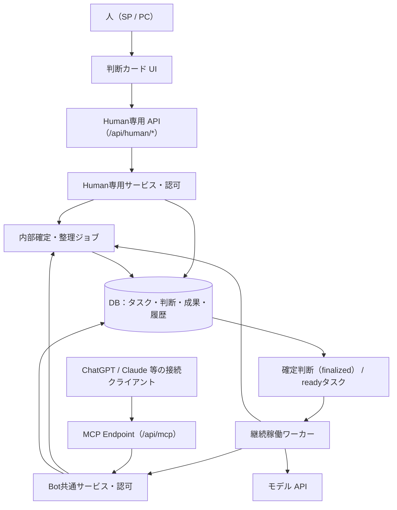

# Bot連携・状態設計

作成日：2026-11-18 ／ 状態：設計基準（未実装）

[企画・要件書](concept.md)の「Botが管理し、人はスワイプで選択する」を実現するための構成。仕様名・操作名は本アプリの提案であり、各社製品の既存API名ではない。

## 1. 接続方針と確認できた事実

共通の業務処理をHTTP APIとMCPから呼べるようにする。MCPはBotへ操作の名前・引数・結果を伝える接続方式。Botごとに別のタスク管理機能を作らず、権限と状態遷移を共通化する。

| 対象 | 公式情報で確認した範囲 | 本アプリでの連携案・未確認事項 |
| --- | --- | --- |
| ChatGPT | HTTPS上の独自MCPサーバーを接続し、ツールを使う公式手順がある | MCPでタスクとカードを操作。対象アカウント・SP/PCでの設定と利用を実機確認する |
| Claude | remote MCPのカスタムコネクターがある。接続元はクラウド側 | 同じMCPを利用。認証とSP/PCでの往復操作を実機確認する |
| Grok | xAI APIのremote MCP toolsで外部MCPを指定できる | APIワーカー経由を候補とする。一般向けGrokアプリからの直接接続は本調査では未確認 |
| Muse | 正式なサービスを特定できていない | 名称・URLを確認してからMCP、HTTP API等の対応を調べる。対応可能とは断定しない |

根拠：[OpenAIのMCP接続手順](https://developers.openai.com/plugins/build/app-quickstart)、[Claudeのremote MCP案内](https://support.claude.com/en/articles/11175166-get-started-with-custom-connectors-using-remote-mcp)、[xAIのremote MCP tools](https://docs.x.ai/developers/tools/remote-mcp)。2026-11-18に参照。上表は文書上の機能確認であり、このアプリとの接続成功を意味しない。

### 「接続できる」と「自動で動き続ける」を区別する

- 公式チャット経由：ユーザーがそのサービスで会話を実行しているときに、Botがタスクを操作する経路。判断後の自動再開は別途検証が必要。
- APIワーカー経由：サーバー側のワーカーが仕事・判断結果を取得し、モデルAPIとツールを呼んで作業する経路。アプリを閉じても継続できる設計にする。
- 対応するモデルAPIを利用できても、それをChatGPTやClaudeの公式アプリ接続成功とは数えない。

人が毎回Botへ「続けて」と入力しなくてよい体験には後者の仕組みが必要となる、というのが本設計の判断。API利用条件と費用は接続実証の際に確認する。対象Botすべての自律実行を一括で保証しない。

## 2. 構成案

実装は単一リポジトリ構成から開始し、UI・MCP・ワーカーで同じサービス層と更新規則を共有する（MVPではDBの `decisions(finalized)` と `tasks(ready)` をキューとしてポーリングし、将来イベント配送へ置換可能にする）。DBを正とし、モデルの会話履歴を進捗の唯一の保存先にしない。採用技術・ディレクトリ境界の詳細は[システム構成・技術スタック仕様](architecture.md)を参照（クラウドホスティング先は外部Bot接続検証時に確定）。

## 3. データと状態

エンティティ構成、DBテーブル制約、`Task` / `DecisionCard` の状態遷移図、5秒取消・候補グループ排他制御は[データモデル・状態遷移・排他制御仕様](data-and-state.md)を参照。

## 4. 公開インターフェース（Bot MCP / Human API）

### Bot向けMCPツール（`/api/mcp`：全12ツール）

| ツール名 | 必要スコープ | 用途・主要入力 |
| --- | --- | --- |
| `get_workspace_context` | `tasks:read` | 目的、許可範囲、停止状態、状態の意味を取得 |
| `list_tasks` | `tasks:read` | 状態・担当等でカーソル検索し概要一覧を取得 |
| `get_task` | `tasks:read` | 指定タスクの詳細・最新 `version`・関連成果概要を取得 |
| `get_artifact` | `tasks:read` | 指定 `artifact_id`（および版）の長文本文またはURLを別取得 |
| `create_task` | `tasks:write` | タイトル、説明、親タスク、`requires_approval` を指定して作成 |
| `claim_task` | `tasks:write` | 作業権（`lease_token`）を期限付き取得。別Bot占有中・一時停止中は取得不可 |
| `renew_lease` | `tasks:write` | 保有中 `lease_token` の有効期限を延長 |
| `update_task` | `tasks:write` | 担当作業の説明・`blocked` 理由・成果参照を更新。`expected_version`・`lease_token` 検証 |
| `submit_proposal` | `proposals:write` | 単一提案または同一 `selection_group_id` の複数候補配列（`1..N`件）を一括登録し `waiting_human` へ遷移・占有解放 |
| `supersede_proposal` | `proposals:write` | `waiting_human`（または `running`）の既存未確定カードを `superseded` にし新版を登録（`provisional` 中は拒否） |
| `list_decision_results` | `decisions:read` | 確定済みの判断（`status = 'finalized'` のみ）をカーソル取得 |
| `record_result` | `tasks:write` | 実行結果・成果・失敗理由を保存。`decision_id` 指定時は `consumed_at` を記録し、`requires_approval = false` の成功時のみ `done` へ遷移 |

### Human専用API（`/api/human/*`）

| エンドポイント | 用途 | 必須検証 |
| --- | --- | --- |
| `POST /api/human/auth/login` `POST /api/human/auth/logout` `GET /api/human/auth/session` | 所有者ログイン・ログアウト・セッション状態取得 | ログイン変更系は `Origin`（CSRF）検証 |
| `GET /api/human/cards` | 判断待ちカード一覧（`pending` / `deferred` フィルタ、自分の `provisional` を含む） | 所有者セッション |
| `GET /api/human/cards/:id` | カード詳細、対象 `Artifact` プレビュー、同グループ候補比較、復帰時の最新状態取得 | 所有者セッション |
| `POST /api/human/cards/:id/decide` | 採用／見送りの仮確定（`pending → provisional`、5秒猶予開始） | 所有者セッション、CSRF、`expected_version`、`request_id`、`expires_at > now`、対象Task/Artifact版、候補グループ未ロック |
| `POST /api/human/cards/:id/undo` | 5秒以内の取り消し（`provisional → pending`） | 所有者セッション、CSRF、`expected_version`、`request_id`、`now < provisional_until` 排他検証（`DEC-01`） |
| `POST /api/human/cards/:id/defer` | 保留・復帰（`pending ⇄ deferred` のみ許可） | 所有者セッション、CSRF、`expected_version`、`request_id` |
| `GET /api/human/board` | 状況画面：Bot進行状況・待機/失敗理由・読み取り専用カンバン取得 | 所有者セッション（列移動・タスク直接編集APIは非提供、`UX-01`） |
| `POST /api/human/tasks/:id/retry` | `failed / blocked → ready` の再開・再試行指示 | 所有者セッション、CSRF、`expected_version`、`request_id` |
| `GET /api/human/history` | 履歴画面：確定済みの採用・見送り・成果・イベント一覧 | 所有者セッション、カーソルページング |
| `GET /api/human/workspace` `PATCH /api/human/workspace` | 初回設定・目的・許可範囲・上限・緊急一時停止（`is_paused`）の取得・更新 | 更新時は所有者セッション、CSRF、`expected_version`、`request_id` |
| `GET /api/human/bots` `POST /api/human/bots` `PATCH /api/human/bots/:id` | Bot接続一覧・発行・`scopes` 変更・一時停止（`paused`）・失効（`revoked`） | 更新時は所有者セッション、CSRF、`expected_version`、`request_id` |

### 停止・失効・スコープ境界

| 状態 / 設定 | サーバー制御（結論） | エラーコード |
| --- | --- | --- |
| `workspaces.is_paused = true` | 全Botの新規占有・書込（`create_task` / `claim_task` / `update_task` / `submit_proposal` 等）を拒否し、Workerの新規実行を停止 | `WORKSPACE_PAUSED` |
| `bot_connections.status = 'paused'` | 当該Botの新規占有・書込操作を拒否（読取のみ許可） | `NOT_AUTHORIZED` |
| `bot_connections.status = 'revoked'` | 当該Botの全読書きを即時拒否し、保有中の `work_leases` を無効化 | `NOT_AUTHORIZED` |
| `bot_connections.scopes` 不足 | ツールごとの必要スコープを持たない呼び出しを拒否 | `NOT_AUTHORIZED` |

- 禁止：Bot向けMCPに承認・取消・保留・タスク強制再開・権限付与操作を公開すること（`BOT-02`）
- 仕様規則：各MCPツールはJSON Schemaで必須引数・列挙値を定義し短い概要を返す。一覧はページングし長文成果は `get_artifact` で別取得にする。曖昧な一致は候補を返し推測更新しない。

### 共通の更新規則

- 作成・更新に`request_id`を要求。同じ認証主体・操作・`request_id`・入力は同じ結果を返す。入力が異なる再利用は `IDEMPOTENCY_CONFLICT` で拒否する。
- 更新には`expected_version`を要求し、競合時は `VERSION_CONFLICT` で再取得を促す。無条件の後勝ち上書きをしない。
- 操作元Botは認証情報から決める。Botが送った表示名を本人確認に使わない。
- 成功時は対象ID、保存後のversion、状態、追跡用IDを返す。エラーは`code`、`message`、`retryable`を返す。
- エラーコード：`VALIDATION_ERROR`、`NOT_AUTHORIZED`、`NOT_FOUND`、`IDEMPOTENCY_CONFLICT`、`VERSION_CONFLICT`、`LEASE_CONFLICT`、`GROUP_LOCKED`、`INVALID_TRANSITION`、`STALE_PROPOSAL`、`WORKSPACE_PAUSED`、`RATE_LIMITED`。

## 5. 人の判断と実行の結合

1. Botが採用時に行う操作、対象ID・版、説明をProposalに固定する。
2. 人が右へスワイプすると、サーバーが権限・有効期限・対象版を確認して仮確定する。
3. 取り消し猶予の終了後、同じトランザクションで判断を確定し、通知予定を永続化する。
4. キュー配送は再送されてもよい。ワーカーはdecision_idを使って二重処理を防ぐ。
5. 実行直前にも対象版・権限・提案内容を検証する。変わっていれば古い承認を流用せず、新しいカードへ差し替える。
6. Botが結果を記録し、必要に応じて次のカードを作成する。

判断の採用と処理の成功は別々に記録する。失敗は採用済みのまま「実行失敗」と表示する。再試行しても同じ処理が重複しないようにし、不明な外部結果を成功や失敗と決めつけない。

MVPの処理対象はタスク管理・調査・下書き・成果登録。将来の外部公開・送信・課金では、サービス側の冪等性や実行結果確認も含めた追加設計を行う。

## 6. ワーカーの責務

- 判断結果・未着手タスクを定期取得する。初期案は稼働時10秒間隔、後からイベント配送に置き換えられるようにする。
- タスクを期限付きで占有し、実行中は延長する。失効後の古い占有トークンによる更新を拒否する。
- 人の判断待ちでは占有を解除し、長時間のモデル呼び出しを維持しない。
- 再起動後はDBから再開する。期限切れ作業は進捗を確認して再取得し、最初から無条件に重複実行しない。
- 回数・時間・費用上限、失敗の再試行上限、手動停止を設ける。無限の再提案ループを避ける。
- 複数Botの役割は固定しない。まず1つの実行経路を通し、担当取得の仕組みを使って追加する。

## 7. 認証・データ境界

人はログインした所有者、Botは接続ごとの認証主体として分離する。チャット接続はOAuth等の対応方式を接続実証で決め、ワーカーには限定権限の資格情報を発行する。失効した接続は以後の読み書きを拒否する。

全読み書きでworkspace_idと権限をサーバー側で検証する。Botに全体管理者権限を与えず、モデルAPIの秘密鍵をブラウザー・カード本文・通常ログへ出さない。外部モデルには実行に必要なタスク情報だけを渡す。

タスク本文・成果・リンク先に書かれた命令から権限を拡大しない。モデルへの注意文だけに頼らず、実行可能な操作・対象・承認状態をサーバーで制限する。

## 8. 接続実証と完了基準

| 経路 | 実証項目 | 現在 |
| --- | --- | --- |
| ChatGPT公式クライアント | 認証→検索→タスク作成→カード提出→確定結果取得。SP/PCの可否を記録 | 未実施 |
| Claude公式クライアント | 同上。接続元からサーバーへ到達できることも確認 | 未実施 |
| Grok APIワーカー | 同上に加え、人の判断後に追加チャット入力なしで再開 | 未実施 |
| Muse | サービス特定→連携方式の確認→同じ操作契約を検証 | 未特定 |

共通で、認証失効、別ワークスペースへのアクセス拒否、二重要求、同時採用、取り消しとの競合、期限切れ、実行中クラッシュを検証する。公式チャット、APIワーカー、SP、PCの結果を分けて記録し、未確認の経路を対応済みにしない。
