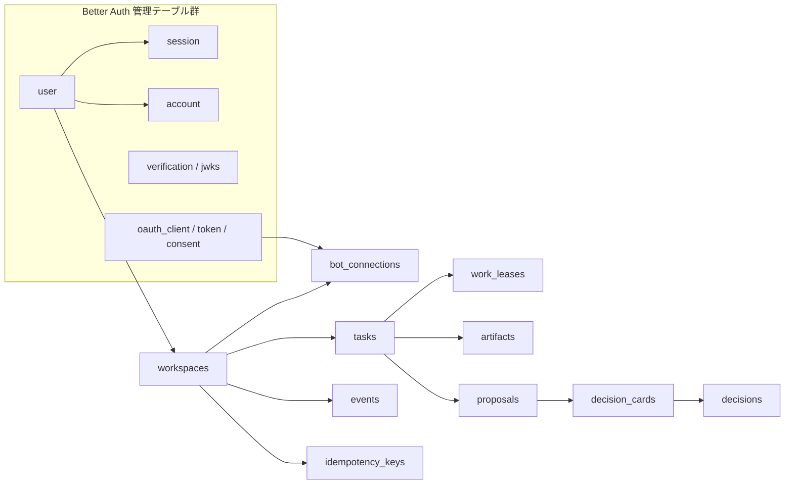
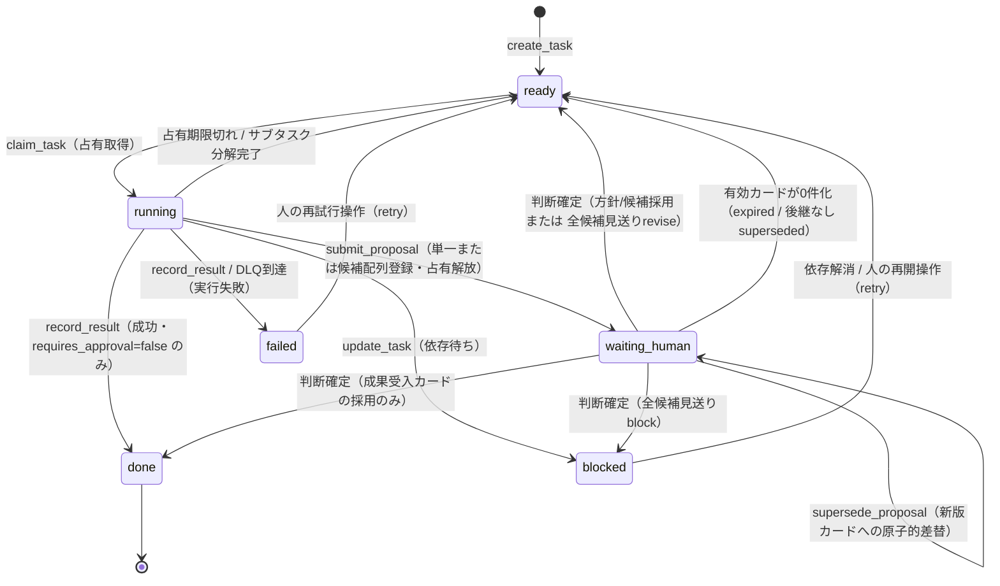
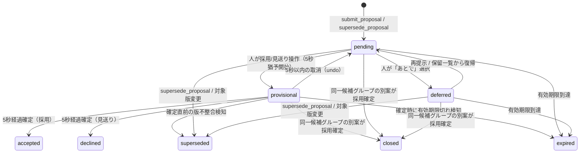
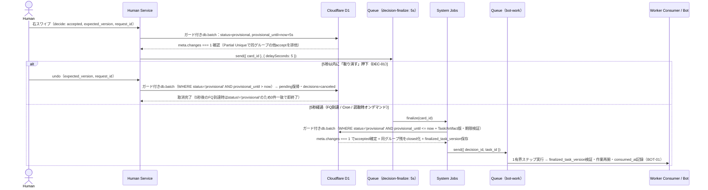

# データモデル・状態遷移・排他制御仕様

作成日：2026-11-18 ／ 状態：設計基準（未実装）

## 1. エンティティ構成（Cloudflare D1 / Drizzle）

| テーブル | 主キー / 一意・検査制約 | 主要カラム | 状態・列挙値 |
| --- | --- | --- | --- |
| `user` / `session` / `account` / `verification` / `jwks` / `oauth_*` | Better Auth 標準PK・Unique（`user.email`, `session.token`, `oauth_client.client_id`） | Better Auth Drizzle Adapter 生成スキーマ（`jwt` + `@better-auth/mcp` OAuth 2.1 テーブル含む） | Human認証および公式MCP OAuth基盤 |
| `workspaces` | `id` / Unique: `owner_user_id` | `owner_user_id`, `goal`, `allowed_scope`, `budget_limit`, `is_paused`, `version` | MVPは1所有者1ワークスペース |
| `bot_connections` | `id` Unique: `token_hash` / Unique: `(workspace_id, oauth_client_id)` `CHECK (oauth_client_id IS NOT NULL OR token_hash IS NOT NULL)` | `workspace_id`, `display_name`, `channel_type`, `oauth_client_id`, `token_hash`, `scopes`, `status`, `version` | `channel_type`: `mcp_oauth` / `worker_bearer` `status`: `active` / `paused` / `revoked` |
| `tasks` | `id` | `workspace_id`, `parent_task_id`, `title`, `description`, `status`, `status_reason`, `requires_approval`, `assigned_bot_id`, `retry_count`, `version`, `updated_at` | `status`: `ready` / `running` / `waiting_human` / `done` / `blocked` / `failed` |
| `work_leases` | `task_id`（PK） | `bot_id`, `lease_token`, `expires_at` | 1タスク最大1占有（`bot_id` は `bot_connections.id`） |
| `proposals` | `id` | `workspace_id`, `task_id`, `proposer_bot_id`, `card_type`, `title`, `summary`, `on_accept_effect`, `on_decline_effect`, `on_decline_policy`, `factors_json`, `target_task_version`, `target_artifact_id`, `target_artifact_version`, `payload_hash`, `superseded_by_id` | `card_type`: `policy` / `choice` / `deliverable` `on_decline_policy`: `revise` / `block`（同一候補グループ内は統一必須） |
| `decision_cards` | `id` Partial Unique: `selection_group_id`（`accepted` または `provisional(accepted)` はグループ内最大1件） | `workspace_id`, `proposal_id`, `selection_group_id`, `status`, `provisional_result`, `provisional_until`, `expires_at`, `version` | `status`: `pending` / `provisional` / `accepted` / `declined` / `deferred` / `superseded` / `closed` / `expired` `provisional_result`: `accepted` / `declined` |
| `decisions` | `id` Partial Unique: `card_id`（`WHERE status IN ('provisional', 'finalized')`） | `card_id`, `actor_user_id`, `result`, `status`, `card_version`, `finalized_task_version`, `provisional_at`, `finalized_at`, `canceled_at`, `consumed_at` | `result`: `accepted` / `declined` `status`: `provisional` / `canceled` / `finalized` |
| `artifacts` | `id` | `workspace_id`, `task_id`, `created_by_bot_id`, `title`, `kind`, `summary`, `content_or_url`, `version` | 一覧は `summary`、長文は `get_artifact` で取得 |
| `events` | `id` | `workspace_id`, `actor_type`, `actor_id`, `entity_type`, `entity_id`, `action`, `payload_json`, `request_id`, `created_at` | 監査・履歴・失敗理由追跡用 |
| `idempotency_keys` | `(workspace_id, actor_type, actor_id, operation, request_id)` | `input_hash`, `response_json`, `created_at` | 再送時の二重実行防止（`DEC-02`） |

- 禁止：許可されたオーナー以外の自由サインアップを受け付けること（Better Auth `databaseHooks` 等で初期オーナー以外は拒否する）
- 禁止：D1 `db.batch` 内で先行条件付き `UPDATE` が0件一致のときに無条件の後続SQLや Queue `send()` を通すこと（後続SQLは更新後親状態の `EXISTS (...)` / `WHERE changes() = 1` または0件時ロールバック用ガードで保護し、`meta.changes === 1` 確認後にのみ Queue 投入する）

---

## 2. `Task` 状態遷移

| 遷移 | 実行主体 | 必須条件 |
| --- | --- | --- |
| `[*] → ready` | Bot | `create_task`（事前許可範囲は `requires_approval = false`、成果承認必須は `true`） |
| `ready → running` | Bot | `claim_task`：有効な他Botの `work_leases` が無く、`workspaces.is_paused = false` |
| `running → waiting_human` | Bot | `submit_proposal`：単一提案または同一 `selection_group_id` の候補配列（`1..N`件、必要に応じ `artifacts` Upsert含む）をガード付き `db.batch` で一括登録し占有解放。遷移後の `task.version` を `proposals.target_task_version` に保存 |
| `waiting_human → waiting_human` | Bot | `supersede_proposal`：`expected_version` 一致かつ対象カードが `provisional` でないことを確認し、旧カードを `superseded`（`superseded_by_id` 記録）にして後継カードを同時登録・`task.version` を更新 |
| `running → done` | Bot | `record_result(success)`：`requires_approval = false` かつ有効な `lease_token`・`expected_version` 一致 |
| `running → ready / blocked` | Bot / System | サブタスク分解完了・依存待ち更新（Bot）、または占有 `expires_at` 失効回収（Cron / System） |
| `running → failed` | Bot / System | `record_result(failed)` または `bot-work-dlq` 到達時に `status_reason` と `retry_count` を記録し占有解放（`BOT-03`） |
| `waiting_human → done` | System（確定時） | `card_type = deliverable` が `accepted` 確定し、`task.version == target_task_version` かつ対象 `Artifact` 版一致 |
| `waiting_human → ready / blocked` | System（確定/失効時） | ① `policy` / `choice` の `accepted` 確定（`ready`）、② 単一またはグループ内**全候補**の `declined` 確定（`on_decline_policy = revise` は `ready`、`block` は `blocked`。未決候補が残る間は `waiting_human` 維持）、③ 有効カードが全て `expired` / 後継なし `superseded` となった場合（`ready`） |
| `blocked / failed → ready` | Human / Bot | Human API `POST /api/human/tasks/:id/retry`、またはBotによる前提タスク解消 |

- 禁止：`requires_approval = true` のタスクを `submit_proposal(deliverable)` の採用確定なしに `done` へ遷移させること
- 禁止：見送り（`declined`）や作業失敗（`failed`）を `done` として扱うこと（`BOT-03`）

---

## 3. `DecisionCard` 状態遷移

- 遷移規則：`provisional` から `pending / superseded / closed / expired` へ移る場合は、親カードの更新成立（`changes() = 1`）を条件に同一 `db.batch` で `decisions(status='provisional')` を `status = 'canceled'`（`canceled_at` 記録）へ更新する。
- 禁止：`provisional` 状態のカードを確定済み承認としてBot・Workerへ渡すこと（`DEC-01`）
- 禁止：確定後（`accepted` / `declined`）のカードを `undo` や `superseded` で書き換えること（変更希望・再確認は新規カードを作成する）

---

## 4. 5秒取消・Queue確定・Worker再開シーケンス

---

## 5. 競合・異常系ガードレール一覧

| ケース | 受け入れ条件 | サーバー制御（結論） | エラーコード |
| --- | --- | --- | --- |
| 5秒取消とQueue確定の同時到達 | `DEC-01` | D1の条件付き `UPDATE`（`provisional_until > now` vs `provisional_until <= now` かつ `status = 'provisional'`）と0件一致時の後続SQL抑止ガードで単一勝者に排他。確定後の `undo` は拒否、取消後のQueueメッセージはNo-op `ack()` | `INVALID_TRANSITION` |
| `provisional` 中の `supersede_proposal` | `DEC-01` | 対象カード（または同グループ内カード）が `provisional` の間は差替を拒否（`retryable: true`） | `INVALID_TRANSITION` |
| 2端末・Queue再配送による二重実行 | `DEC-02` | APIは `request_id` 冪等キー＋`expected_version` で排他。Queue Consumerはメッセージ単位 `ack()/retry()` と `decision_id`（`consumed_at`）・`WorkLease` で二重着手を防止 | `IDEMPOTENCY_CONFLICT` / `VERSION_CONFLICT` |
| 古いカード・変更済み提案への操作と実行 | `DEC-03` | ①`supersede_proposal` 済カードへの操作時は `STALE_PROPOSAL` と後継の再確認カードIDを返却。②仮確定・確定時に `task.version != target_task_version`（または対象 `Artifact` 版不一致）を検知した場合はカードを `superseded` 化し、後継カードが無ければTask版再確認用の新規 `DecisionCard` を自動生成して提示。③Worker実行直前の `finalized_task_version` 不一致時は確定済みカードを書き換えず新規の再確認カードを提出 | `STALE_PROPOSAL` |
| 複数候補グループの排他選択 | `DEC-04` | Partial Unique制約で `provisional(accepted)` / `accepted` をグループ内1件に強制。`provisional(accepted)` 中は同グループ他候補の `decide` / `defer` も拒否し判断待ち一覧から一時除外（5秒取消で再表示、`accepted` 確定で `closed` 化）。全候補 `declined` 確定時のみ「選択なし」としてTaskを遷移 | `GROUP_LOCKED` |
| 権限外・停止中・失効済みの操作 | `BOT-02` | OAuth JWT・Bearer双方で毎リクエストD1の `bot_connections` を照合し `workspace_id` を強制。`revoked` はOAuthトークン/同意・占有も同時失効して全操作即時拒否、`paused` / `is_paused` は書込・新規占有を拒否 | `NOT_AUTHORIZED` / `WORKSPACE_PAUSED` |
| 占有期限切れ・再試行上限超過 | `BOT-03` | 更新時に `lease_token` と `expires_at > now` を検証。Queue再試行上限超過（DLQ退避）時は `Task` を `failed`（理由記録）へ遷移し完了扱いしない | `LEASE_CONFLICT` |
