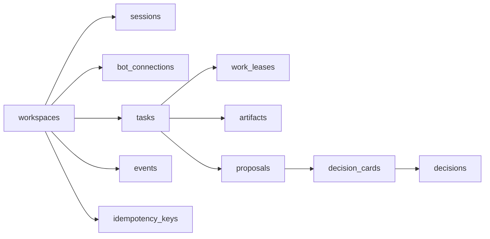
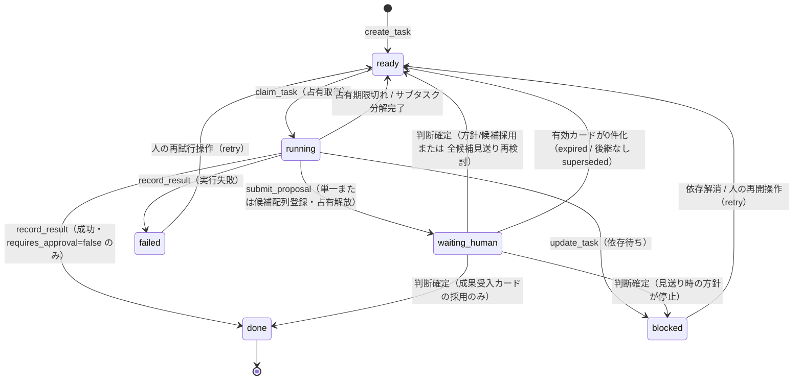
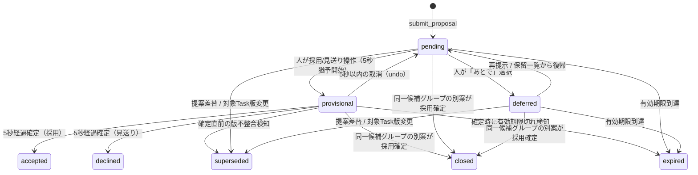
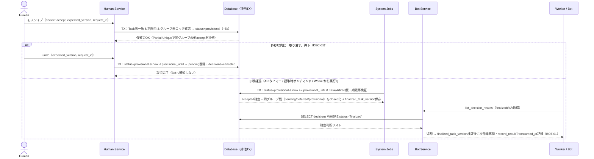

# データモデル・状態遷移・排他制御仕様

作成日：2026-11-18 ／ 状態：設計基準（未実装）

## 1. エンティティ構成

| テーブル | 主キー / 一意制約 | 主要カラム | 状態・備考 |
| --- | --- | --- | --- |
| `workspaces` | `id` | `owner_user_id`, `goal`, `allowed_scope`, `budget_limit`, `is_paused`, `version` | MVPは1所有者1ワークスペース |
| `sessions` | `id` / Unique: `token_hash` | `workspace_id`, `user_id`, `token_hash`, `expires_at`, `created_at` | Human専用 `HttpOnly` セッション管理 |
| `bot_connections` | `id` / Unique: `token_hash` | `workspace_id`, `display_name`, `channel_type`, `token_hash`, `scopes`, `status`, `version` | `status`: `active` / `paused` / `revoked` |
| `tasks` | `id` | `workspace_id`, `parent_task_id`, `title`, `description`, `status`, `status_reason`, `requires_approval`, `assigned_bot_id`, `retry_count`, `version`, `updated_at` | `version` で楽観ロック |
| `work_leases` | `task_id`（PK） | `bot_id`, `lease_token`, `expires_at` | 1タスク最大1占有 |
| `proposals` | `id` | `workspace_id`, `task_id`, `proposer_bot_id`, `card_type`, `title`, `summary`, `on_accept_effect`, `on_decline_effect`, `on_decline_policy`, `factors_json`, `target_task_version`, `target_artifact_id`, `target_artifact_version`, `payload_hash`, `superseded_by_id` | `card_type`: `policy` / `choice` / `deliverable` |
| `decision_cards` | `id` Partial Unique: `selection_group_id`（`accepted` または `provisional(accept)` はグループ内最大1件） | `workspace_id`, `proposal_id`, `selection_group_id`, `status`, `provisional_result`, `provisional_until`, `expires_at`, `version` | 5秒仮確定状態・グループ排他を保持 |
| `decisions` | `id` Partial Unique: `card_id`（`WHERE status IN ('provisional', 'finalized')`） | `card_id`, `actor_user_id`, `result`, `status`, `card_version`, `finalized_task_version`, `provisional_at`, `finalized_at`, `canceled_at`, `consumed_at` | `status`: `provisional` / `canceled` / `finalized` |
| `artifacts` | `id` | `workspace_id`, `task_id`, `created_by_bot_id`, `title`, `kind`, `summary`, `content_or_url`, `version` | 一覧は `summary`、長文は `get_artifact` で取得 |
| `events` | `id` | `workspace_id`, `actor_type`, `actor_id`, `entity_type`, `entity_id`, `action`, `payload_json`, `request_id`, `created_at` | 監査・履歴・失敗理由追跡用 |
| `idempotency_keys` | `(workspace_id, actor_type, actor_id, operation, request_id)` | `input_hash`, `response_json`, `created_at` | 再送時の二重実行防止（`DEC-02`） |

---

## 2. `Task` 状態遷移

| 遷移 | 実行主体 | 必須条件 |
| --- | --- | --- |
| `[*] → ready` | Bot | `create_task`（事前許可範囲タスクは `requires_approval = false`、成果承認必須は `true`） |
| `ready → running` | Bot | `claim_task`：有効な他Botの `work_leases` が無く、`workspaces.is_paused = false` |
| `running → waiting_human` | Bot | `submit_proposal`：単一提案または同一 `selection_group_id` の候補配列（`1..N`件）を単一TXで登録し占有解放。遷移後の `task.version` を `proposals.target_task_version` に保存 |
| `running → done` | Bot | `record_result(success)`：`requires_approval = false` かつ有効な `lease_token`・`expected_version` 一致 |
| `running → ready / blocked` | Bot / System | サブタスク分解完了・依存待ち更新（Bot）、または占有 `expires_at` 失効回収（System） |
| `running → failed` | Bot / Worker | `record_result(failed)`：`status_reason` と `retry_count` を記録し占有解放（`BOT-03`） |
| `waiting_human → done` | System（確定時） | `card_type = deliverable` が `accepted` 確定し、`task.version == target_task_version`（および対象 `Artifact` 版一致） |
| `waiting_human → ready / blocked` | System（確定/失効時） | ① `policy` / `choice` の `accepted` 確定、② 単一カードまたはグループ内**全候補**の `declined` 確定（未決候補が残る間は `waiting_human` を維持）、③ 有効カードが全て `expired` / 後継なし `superseded` となった場合 |
| `blocked / failed → ready` | Human / Bot | Human API `POST /api/human/tasks/:id/retry`（失敗・停止からの再開）、またはBotによる前提タスク解消 |

- 禁止：`requires_approval = true` のタスクを `submit_proposal(deliverable)` の採用確定なしに `done` へ遷移させること
- 禁止：見送り（`declined`）や作業失敗（`failed`）を `done` として扱うこと（`BOT-03`）

---

## 3. `DecisionCard` 状態遷移

- 遷移規則：`provisional` から `pending / superseded / closed / expired` へ移る場合は、同一TXで対応する `decisions(status='provisional')` を `status = 'canceled'`（`canceled_at` 記録）に更新する。
- 禁止：`provisional` 状態のカードを確定済み承認としてBot・Workerへ渡すこと（`DEC-01`）
- 禁止：確定後（`accepted` / `declined`）のカードを `undo` や `superseded` で書き換えること（変更希望・再確認は新規カードを作成する）

---

## 4. 5秒取消・候補グループ排他・版検証シーケンス

---

## 5. 競合・異常系ガードレール一覧

| ケース | 受け入れ条件 | サーバー制御（結論） | エラーコード |
| --- | --- | --- | --- |
| 5秒取消と確定処理の同時到達 | `DEC-01` | 単一DBトランザクションで `status = 'provisional'` と `provisional_until` を排他判定。確定後の `undo` は拒否 | `INVALID_TRANSITION` |
| `provisional` 中の `supersede_proposal` | `DEC-01` | 対象カード（または同グループ内カード）が `provisional` の間は差替を拒否（`retryable: true`、最大5秒後に再試行または確定結果を取得） | `INVALID_TRANSITION` |
| 2端末・通信再送による二重送信 | `DEC-02` | `request_id`＋同一入力は保存済み応答を返却。同一 `request_id` で別入力は `IDEMPOTENCY_CONFLICT`、別 `request_id` の競合は `VERSION_CONFLICT` で拒否 | `IDEMPOTENCY_CONFLICT` / `VERSION_CONFLICT` |
| 古い提案・変更済みTaskへの承認と実行 | `DEC-03` | ①仮確定・確定時は `task.version == target_task_version`（＋対象 `Artifact` 版）を検証し不一致ならカードを `superseded` 化。②Worker実行直前は `task.version == finalized_task_version` を検証し不一致なら確定済みカードを書き換えず実行を止め新規の再確認カードを提出 | `STALE_PROPOSAL` |
| 複数候補グループの排他選択 | `DEC-04` | `provisional(accept)` 中は同グループの別 `accept` を拒否。`accepted` 確定で残り全候補を `closed` 化。全候補が `declined` 確定した時点でのみ「選択なし」としてTaskを遷移（最後の候補を自動採用しない） | `GROUP_LOCKED` |
| 権限外・停止中・失効済みの操作 | `BOT-02` | 全クエリに認証由来の `workspace_id` を強制。`revoked` は全操作拒否＋占有無効化、`paused` / `is_paused` は書込・新規占有を拒否 | `NOT_AUTHORIZED` / `WORKSPACE_PAUSED` |
| 占有期限切れBotの遅延更新 | `BOT-03` | `work_leases.lease_token` と `expires_at > now` を更新時に検証し、失効後の書き込みを拒否 | `LEASE_CONFLICT` |
