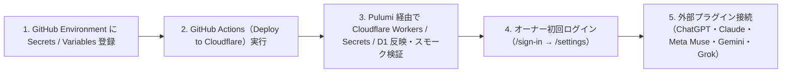

# Cloudflare デプロイ・外部プラグイン接続ランブック

作成日：2026-11-20 ／ 状態：手順基準（インフラ構築・マルチプロバイダワーカー・GitHub Secrets自動連携コード実装完了 ／ 検証・本番環境への実デプロイおよび各外部 Bot 実機接続実証は認証情報設定後に実施）

## 1. デプロイ・プラグイン接続の全体フロー

- 禁止：秘密鍵・トークン平文を `infra/Pulumi.*.yaml` や Git・GitHub Actions `vars.*` へ直接記載すること（必ず GitHub Secrets または `pulumi config set --secret` を使用し、`infra/index.ts` で `pulumi.secret(...)` 暗号化管理する）（強制: `tests/guardrails/infra-guardrails.test.ts`, `.gitignore`）
- 禁止：未デプロイ環境や未実証の外部 Bot 接続を「対応済」と記載すること（実機疎通の証跡取得後に更新する）（強制: `scripts/check-guardrails.ts`）

---

## 2. 事前準備（Cloudflare・GitHub OAuth・Pulumi State・モデルAPI）

| サービス                              | 作成・取得する値                                                                  | 設定値 / 必須権限                                                                                                                                                                              |
| ------------------------------------- | --------------------------------------------------------------------------------- | ---------------------------------------------------------------------------------------------------------------------------------------------------------------------------------------------- |
| Cloudflare（Workers Paid プラン必須） | `CLOUDFLARE_ACCOUNT_ID` / `CLOUDFLARE_API_TOKEN`                                  | Queues・`limits.cpuMs: 10000` に Workers Paid プランが必須。Token 権限：Workers Scripts（Edit）・D1（Edit）・Queues（Edit）・Workers Routes / Custom Domains（Edit）・Account Settings（Read） |
| Cloudflare DNS（`prod` 必須）         | `CLOUDFLARE_ZONE_ID` / `CUSTOM_HOSTNAME`                                          | 例：`bot-board.example.com`（`BETTER_AUTH_URL` のホスト名と完全一致必須）                                                                                                                      |
| Pulumi State Backend（必須）          | `PULUMI_ACCESS_TOKEN`（または `PULUMI_BACKEND_URL` + `PULUMI_CONFIG_PASSPHRASE`） | GitHub Actions 実行間で D1 UUID・Queue 状態を保持するため必須（個人無料枠の Pulumi Cloud `PULUMI_ACCESS_TOKEN` が最短）                                                                        |
| GitHub OAuth App                      | `GITHUB_CLIENT_ID` / `GITHUB_CLIENT_SECRET`                                       | **Authorization callback URL**：`https://<domain>/api/auth/callback/github`（`staging` / `prod` で別 App 推奨）                                                                                |
| GitHub アカウント                     | `OWNER_GITHUB_ID`                                                                 | オーナー本人の数値 GitHub User ID（`gh api user --jq .id` で取得）                                                                                                                             |
| Better Auth                           | `BETTER_AUTH_SECRET`                                                              | 32 バイト以上のランダム文字列（`openssl rand -base64 32`）                                                                                                                                     |
| モデル API（自律ワーカー用・1つ以上） | `GEMINI_API_KEY` / `XAI_API_KEY` / `META_MODEL_API_KEY`                           | `WORKER_LLM_PROVIDER`（`gemini` / `grok` / `meta-muse`）に対応するキーを設定（未指定時は `XAI` → `GEMINI` → `META` の順で自動選択。`prod` は選択プロバイダのキー必須）                         |

---

## 3. GitHub Secrets → GitHub Actions → Cloudflare Secrets 自動デプロイ

GitHub リポジトリの **`Settings → Environments`** に **`staging`**（`staging` スタック用）および **`prd-deploy`**（`prod` スタック用）環境を作成し、以下を登録して Actions タブの **`Deploy to Cloudflare`** を実行すると、ローカルでの `pulumi config set` 不要で Cloudflare Worker Secrets まで一括同期される（Repository Secrets / Variables に登録した共通値も自動継承され、ローカルから `pulumi config set` で設定した値がある場合は Pulumi 側が優先される）。

### 3.1 GitHub Environment Secrets（必ず Secrets へ登録・`vars.*` 禁止）

| GitHub Secret 名                                                | 反映先（Cloudflare / Runner）             | 必須条件                                                                                                                                                              |
| --------------------------------------------------------------- | ----------------------------------------- | --------------------------------------------------------------------------------------------------------------------------------------------------------------------- |
| `CLOUDFLARE_API_TOKEN`                                          | GitHub Actions（Pulumi / D1 API）         | 必須（`staging` / `prd-deploy`）                                                                                                                                      |
| `PULUMI_ACCESS_TOKEN`                                           | GitHub Actions（Pulumi Cloud 状態保存）   | Pulumi Cloud 利用時は必須（R2 等セルフホスト時は未設定とし、代わりに `PULUMI_BACKEND_URL` + `PULUMI_CONFIG_PASSPHRASE` を使用）                                       |
| `PULUMI_BACKEND_URL`                                            | GitHub Actions（セルフホスト Backend）    | セルフホスト Backend（R2/S3等：`s3://<bucket>?endpoint=https://<accountId>.r2.cloudflarestorage.com&region=auto&s3ForcePathStyle=true`）利用時のみ                    |
| `PULUMI_CONFIG_PASSPHRASE`                                      | GitHub Actions（セルフホスト暗号化鍵）    | セルフホスト Backend 利用時は必須（空値時は `infra/deploy.ts` が実行前に拒否）                                                                                        |
| `AWS_ACCESS_KEY_ID` / `AWS_SECRET_ACCESS_KEY`                   | GitHub Actions（R2/S3 Backend 認証）      | R2/S3 セルフホスト Backend（`s3://...`）利用時のみ                                                                                                                    |
| `BETTER_AUTH_SECRET`                                            | Cloudflare Worker Secret（`secret_text`） | 必須（`staging` / `prd-deploy`、16 文字以上）                                                                                                                         |
| `GITHUB_CLIENT_ID`                                              | Cloudflare Worker Secret（`secret_text`） | 必須（`staging` / `prd-deploy`）                                                                                                                                      |
| `GITHUB_CLIENT_SECRET`                                          | Cloudflare Worker Secret（`secret_text`） | 必須（`staging` / `prd-deploy`）                                                                                                                                      |
| `GEMINI_API_KEY`（GitHub Actions 別名 `GOOGLE_GEMINI_API_KEY`） | Cloudflare Worker Secret（`secret_text`） | `WORKER_LLM_PROVIDER=gemini` 時は `prd-deploy`（`prod` スタック）必須（`staging` 任意・月次枠はキー側で制限可。ローカル `bun run deploy` は `GEMINI_API_KEY` を参照） |
| `XAI_API_KEY`                                                   | Cloudflare Worker Secret（`secret_text`） | `WORKER_LLM_PROVIDER=grok` 時は `prd-deploy`（`prod` スタック）必須（`staging` 任意）                                                                                 |
| `META_MODEL_API_KEY`                                            | Cloudflare Worker Secret（`secret_text`） | `WORKER_LLM_PROVIDER=meta-muse` 時は `prd-deploy`（`prod` スタック）必須（`staging` 任意）                                                                            |
| `SMOKE_BOT_TOKEN`                                               | GitHub Actions（デプロイ後 MCP スモーク） | 任意（`/settings` で発行した Worker Bearer）                                                                                                                          |

### 3.2 GitHub Environment Variables（または Secrets でも可）

| 変数名（Pulumi Config 名）                   | 必須条件                   | 設定例 / デフォルト                                                                   |
| -------------------------------------------- | -------------------------- | ------------------------------------------------------------------------------------- |
| `CLOUDFLARE_ACCOUNT_ID`（`accountId`）       | 必須                       | Cloudflare Account ID                                                                 |
| `BETTER_AUTH_URL`（`betterAuthUrl`）         | 必須                       | `https://bot-board-staging.<subdomain>.workers.dev` / `https://bot-board.example.com` |
| `OWNER_GITHUB_ID`（`ownerGithubId`）         | 必須                       | 単一オーナーの数値 GitHub ID（`gh api user --jq .id`）                                |
| `WORKER_LLM_PROVIDER`（`workerLlmProvider`） | 任意                       | `gemini` / `grok` / `meta-muse`（未設定時は登録済み API キーから自動選択）            |
| `GEMINI_MODEL`（`geminiModel`）              | 任意                       | `gemini-3.5-flash-lite`（デフォルト）または `gemini-3.8-flash`                        |
| `XAI_MODEL` / `META_MODEL`                   | 任意                       | `grok-3-mini`（既定） / `muse-spark-1.3`（既定）                                      |
| `TRUSTED_ORIGINS`（`trustedOrigins`）        | 任意                       | カンマ区切り許可 Origin（未設定時は `BETTER_AUTH_URL`）                               |
| `CLOUDFLARE_ZONE_ID` / `CUSTOM_HOSTNAME`     | `prd-deploy`（`prod`）必須 | カスタムドメイン公開先（`CUSTOM_HOSTNAME` は `BETTER_AUTH_URL` のホスト名と一致必須） |

### 3.3 デプロイ実行経路（4 ステップ自動実行）

| 実行経路           | コマンド / トリガー                                   | 自動実行内容（`infra/deploy.ts`）                                                                                                                                                                                                            |
| ------------------ | ----------------------------------------------------- | -------------------------------------------------------------------------------------------------------------------------------------------------------------------------------------------------------------------------------------------- |
| GitHub Actions     | `.github/workflows/deploy.yml`（`workflow_dispatch`） | `bun run verify` 通過後、環境 Secrets/Variables を注入し ① `build` + `build:worker` + `build:infra` → ② `pulumi stack select --create` + `pulumi up --yes` → ③ `migrate-d1.ts` → ④ `smoke.ts`（17 項目）を自動実行                           |
| ローカル CLI       | `bun run deploy -- --stack staging`（または `prod`）  | 上記と同一の 4 ステップをローカル実行（Pulumi Config または環境変数を利用）                                                                                                                                                                  |
| 単独スモーク再検証 | `bun run smoke -- --base-url https://<domain>`        | `/api/health`・SPA 4 経路セキュリティヘッダー（`Sec-Fetch-Mode: navigate`）・RFC 9728 / 8414 / OIDC 発見 7 経路 + CORS・JWKS・`OPTIONS /api/mcp`（`HEAD`含む）・`POST`/`HEAD /api/mcp` 401 `WWW-Authenticate`・`/api/human/workspace` を検証 |

---

## 4. 外部プラグイン接続手順（デプロイ・初回ログイン後）

初回デプロイ後、オーナーが `https://<domain>/sign-in` から GitHub ログインし、`/settings` で目的・事前許可範囲・構造化上限（`budget_limit`）を保存してから各プラグインを接続する。

| 対象クライアント / Issue                            | 認証方式・設定パラメータ                                                                                                                                        | 接続手順                                                                                                                                                                                                                                              | 実機実証ステータス             |
| --------------------------------------------------- | --------------------------------------------------------------------------------------------------------------------------------------------------------------- | ----------------------------------------------------------------------------------------------------------------------------------------------------------------------------------------------------------------------------------------------------- | ------------------------------ |
| **ChatGPT Remote MCP**（`#17`）                     | OAuth 2.1（PKCE + DCR + RFC 9728/8414） Endpoint URL：`https://<domain>/api/mcp`（`/settings` からコピー可）                                                 | ① ChatGPT コネクタ作成で Remote MCP URL に `https://<domain>/api/mcp` を指定 → ② 自動発見後に開く `/consent` で必要スコープを絞り込み許可 → ③ `get_workspace_context` / `list_tasks` 疎通確認                                                         | 未実施（デプロイ後実機確認待） |
| **Claude Custom Connector**（`#20`）                | OAuth 2.1（PKCE + DCR + RFC 9728/8414） Endpoint URL：`https://<domain>/api/mcp`                                                                             | ① Claude Custom Connectors で `https://<domain>/api/mcp` を登録 → ② `/consent` でスコープを絞り込み許可 → ③ 12 ツール一覧・`submit_proposal` 疎通確認                                                                                                 | 未実施（デプロイ後実機確認待） |
| **Meta Muse Custom Connector / Model API**（`#33`） | OAuth 2.1（DCR + PKCE S256 + `refresh_token`、`agent.meta.ai` / `muse.ai` callback）または `META_MODEL_API_KEY`（`WORKER_LLM_PROVIDER=meta-muse`）              | ① Meta Muse → `Settings → Connectors → Add custom connector` に `https://<domain>/api/mcp` を登録し `/consent` で許可（Secure Credentials Store Bearer / Muse Code CLI も可） → ② 自律再開時は `META_MODEL_API_KEY` + Worker Bearer で Queue 実行確認 | 未実施（デプロイ後実機確認待） |
| **Google Gemini MCP / Gemini API**（`#34`）         | OAuth 2.1（`HEAD /api/mcp` 発見 + DCR + PKCE S256、`googleusercontent.com` / `vertexaisearch` callback）または `GEMINI_API_KEY`（`WORKER_LLM_PROVIDER=gemini`） | ① Gemini Web（`Settings → Connected Apps → Custom apps`）または `gemini mcp add bot-board --scope user --transport http https://<domain>/api/mcp` で接続し `/consent` で許可 → ② 自律再開時は `GEMINI_API_KEY` + Worker Bearer で Queue 実行確認      | 未実施（デプロイ後実機確認待） |
| **Grok API Worker**（`#18`）                        | `worker_bearer` + Cloudflare Queues + `XAI_API_KEY`（`WORKER_LLM_PROVIDER=grok`）                                                                               | ① `/settings` の「+ Worker Bearer 発行」で `tasks:read` / `tasks:write` / `proposals:write` / `decisions:read` 付ワーカーを作成 → ② `XAI_API_KEY`（任意で `XAI_MODEL`）設定済み環境で `bot-work` Queue 処理を確認                                     | 未実施（デプロイ後実機確認待） |

---

## 5. 公開エンドポイント・セキュリティヘッダー契約

| パス区分                                                                                                  | CORS 方針                                                                                                                                                         | キャッシュ・セキュリティヘッダー                                                                                                                                                          |
| --------------------------------------------------------------------------------------------------------- | ----------------------------------------------------------------------------------------------------------------------------------------------------------------- | ----------------------------------------------------------------------------------------------------------------------------------------------------------------------------------------- |
| `/api/mcp`・`/api/mcp/`                                                                                   | `Access-Control-Allow-Origin: *`、`OPTIONS` `204`（`GET, HEAD, POST, DELETE, OPTIONS`）、`Expose-Headers: WWW-Authenticate, Mcp-Session-Id, MCP-Protocol-Version` | `nosniff`・`DENY`・`no-referrer`・`HSTS`・`Cache-Control: no-store`                                                                                                                       |
| `/.well-known/*`・`/api/auth/.well-known/*`・`/api/auth/jwks`・`/api/auth/oauth2/{register,token,revoke}` | 公開非 Cookie 経路のみ `Access-Control-Allow-Origin: *` + `OPTIONS` `204`（`Allow-Credentials` 禁止）                                                             | `nosniff`・`DENY`・`no-referrer`・`HSTS`（`register` / `token` / `revoke` は `no-store`）                                                                                                 |
| `/api/human/*`・`/api/auth/{sign-in,callback,get-session,sign-out,oauth2/authorize,oauth2/consent}`       | **CORS 付与禁止**（同一オリジン Cookie + `trustedOrigins` CSRF 強制）                                                                                             | `nosniff`・`DENY`・`no-referrer`・`HSTS`・`Cache-Control: no-store`                                                                                                                       |
| SPA 静的配信（`/*`・`/consent`・`/sign-in`）                                                              | 同一オリジン                                                                                                                                                      | `public/_headers` および `infra/index.ts` `STATIC_ASSETS_HEADERS` で `CSP (frame-ancestors 'none')`・`X-Frame-Options: DENY`・`/consent`・`/sign-in` の `no-referrer` + `no-store` を強制 |

- 禁止：Cookie 認証経路（`/api/human/*` およびログイン・同意・セッション系 `/api/auth/*`）へ `Access-Control-Allow-Origin` を付与すること（強制: `tests/integration/plugin-interoperability-security.test.ts`）
- 禁止：`public/_headers` と `infra/index.ts` の `STATIC_ASSETS_HEADERS` を乖離させること（強制: `tests/guardrails/infra-guardrails.test.ts`）
