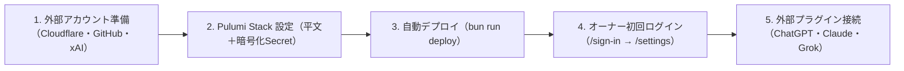

# Cloudflare デプロイ・外部プラグイン接続ランブック

作成日：2026-11-20 ／ 状態：手順基準（インフラ構築・コード実装完了 ／ 検証・本番環境への実デプロイおよび各外部 Bot 実機接続実証は認証情報設定後に実施）

## 1. デプロイ・プラグイン接続の全体フロー

- 禁止：秘密鍵・トークン平文を `infra/Pulumi.*.yaml` や Git へ直接記載すること（必ず `pulumi config set --secret` または GitHub Actions Secrets を使用する）（強制: `tests/guardrails/infra-guardrails.test.ts`, `.gitignore`）
- 禁止：未デプロイ環境や未実証の外部 Bot 接続を「対応済」と記載すること（実機疎通の証跡取得後に更新する）（強制: `scripts/check-guardrails.ts`）

---

## 2. 事前準備（Cloudflare・GitHub OAuth・xAI）

| サービス                              | 作成・取得する値                        | 設定値 / 必須権限                                                                                                                                                                              |
| ------------------------------------- | --------------------------------------- | ---------------------------------------------------------------------------------------------------------------------------------------------------------------------------------------------- |
| Cloudflare（Workers Paid プラン必須） | `accountId` / `CLOUDFLARE_API_TOKEN`    | Queues・`limits.cpuMs: 10000` に Workers Paid プランが必須。Token 権限：Workers Scripts（Edit）・D1（Edit）・Queues（Edit）・Workers Routes / Custom Domains（Edit）・Account Settings（Read） |
| Cloudflare DNS（`prod` 必須）         | `zoneId` / `hostname`                   | 例：`bot-board.example.com`（`betterAuthUrl` のホスト名と完全一致必須）                                                                                                                        |
| GitHub OAuth App                      | `githubClientId` / `githubClientSecret` | **Authorization callback URL**：`https://<domain>/api/auth/callback/github`（`staging` / `prod` で別 App 推奨）                                                                                |
| GitHub アカウント                     | `ownerGithubId`                         | オーナー本人の数値 GitHub User ID（`gh api user --jq .id` で取得）                                                                                                                             |
| Better Auth                           | `betterAuthSecret`                      | 32 バイト以上のランダム文字列（`openssl rand -base64 32`）                                                                                                                                     |
| xAI（Grok Worker 用）                 | `xaiApiKey`                             | `staging` は任意、`prod` は必須（任意で `xaiModel`・`xaiApiUrl` を上書き可）                                                                                                                   |

---

## 3. Pulumi Stack 設定と自動デプロイ

### 3.1 Stack 設定コマンド（`infra/` ディレクトリで実行）

| キー（`bot-board:*`）                   | 種別       | 例 / 説明                                                                       |
| --------------------------------------- | ---------- | ------------------------------------------------------------------------------- |
| `accountId`                             | 平文       | Cloudflare Account ID                                                           |
| `betterAuthUrl`                         | 平文       | `https://<domain>`（`staging` / `prod` は `https://` 必須）                     |
| `trustedOrigins`                        | 平文       | カンマ区切り許可 Origin（未設定時は `betterAuthUrl`）                           |
| `ownerGithubId`                         | 平文       | 許可する単一オーナーの数値 GitHub ID                                            |
| `zoneId` / `hostname`                   | 平文       | カスタムドメイン公開先（`prod` 必須、`hostname` は `betterAuthUrl` と一致必須） |
| `betterAuthSecret`                      | `--secret` | Better Auth HMAC 署名鍵（16 文字以上）                                          |
| `githubClientId` / `githubClientSecret` | `--secret` | GitHub OAuth App 認証情報                                                       |
| `xaiApiKey`                             | `--secret` | xAI Grok API キー（`prod` 必須）                                                |

### 3.2 デプロイ実行（ローカル / GitHub Actions 共通の 4 ステップ）

| 実行経路           | コマンド / トリガー                                   | 必須・任意環境変数 / Secrets および自動実行内容（`infra/deploy.ts`）                                                                                                                                                                               |
| ------------------ | ----------------------------------------------------- | -------------------------------------------------------------------------------------------------------------------------------------------------------------------------------------------------------------------------------------------------- |
| ローカル CLI       | `bun run deploy -- --stack staging`（または `prod`）  | 必須：`CLOUDFLARE_API_TOKEN`（任意：`CLOUDFLARE_ACCOUNT_ID`＝未設定時は Pulumi Stack の `bot-board:accountId` を自動取得、`SMOKE_BOT_TOKEN`）。① `build` + `build:worker` + `build:infra` → ② `pulumi up --yes` → ③ `migrate-d1.ts` → ④ `smoke.ts` |
| GitHub Actions     | `.github/workflows/deploy.yml`（`workflow_dispatch`） | 環境 Secrets：必須 `CLOUDFLARE_API_TOKEN`、Pulumi Cloud 用 `PULUMI_ACCESS_TOKEN`（またはセルフホスト backend 用 `PULUMI_BACKEND_URL` + `PULUMI_CONFIG_PASSPHRASE`）、任意 `CLOUDFLARE_ACCOUNT_ID`・`SMOKE_BOT_TOKEN`                               |
| 単独スモーク再検証 | `bun run smoke -- --base-url https://<domain>`        | `/api/health`・SPA 4 経路セキュリティヘッダー（`Sec-Fetch-Mode: navigate`）・RFC 9728 / 8414 / OIDC 発見 7 経路 + CORS・JWKS・`OPTIONS /api/mcp`・`401 WWW-Authenticate`・`/api/human/workspace` を検証                                            |

---

## 4. 外部プラグイン接続手順（デプロイ・初回ログイン後）

初回デプロイ後、オーナーが `https://<domain>/sign-in` から GitHub ログインし、`/settings` で目的・事前許可範囲・構造化上限（`budget_limit`）を保存してから各プラグインを接続する。

| 対象クライアント / Issue             | 認証方式・設定パラメータ                                                                                        | 接続手順                                                                                                                                                                                                          | 実機実証ステータス             |
| ------------------------------------ | --------------------------------------------------------------------------------------------------------------- | ----------------------------------------------------------------------------------------------------------------------------------------------------------------------------------------------------------------- | ------------------------------ |
| **ChatGPT Remote MCP**（`#17`）      | OAuth 2.1（PKCE + DCR + RFC 9728/8414） Endpoint URL：`https://<domain>/api/mcp`（`/settings` からコピー可） | ① ChatGPT コネクタ作成で Remote MCP URL に `https://<domain>/api/mcp` を指定 → ② 自動発見後に開く `/consent` で必要スコープを絞り込み許可 → ③ `get_workspace_context` / `list_tasks` 疎通確認                     | 未実施（デプロイ後実機確認待） |
| **Claude Custom Connector**（`#20`） | OAuth 2.1（PKCE + DCR + RFC 9728/8414） Endpoint URL：`https://<domain>/api/mcp`                             | ① Claude Custom Connectors で `https://<domain>/api/mcp` を登録 → ② `/consent` でスコープを絞り込み許可 → ③ 12 ツール一覧・`submit_proposal` 疎通確認                                                             | 未実施（デプロイ後実機確認待） |
| **Grok API Worker**（`#18`）         | `worker_bearer` + Cloudflare Queues + `XAI_API_KEY`                                                             | ① `/settings` の「+ Worker Bearer 発行」で `tasks:read` / `tasks:write` / `proposals:write` / `decisions:read` 付ワーカーを作成 → ② `XAI_API_KEY`（任意で `XAI_MODEL`）設定済み環境で `bot-work` Queue 処理を確認 | 未実施（デプロイ後実機確認待） |
| **Muse**（`#19`）                    | サービス公式仕様の特定待                                                                                        | 対象サービス特定後に公式連携経路（MCP OAuth / API Worker）を確定                                                                                                                                                  | 未特定（サービス特定待）       |

---

## 5. 公開エンドポイント・セキュリティヘッダー契約

| パス区分                                                                                                  | CORS 方針                                                                                                                                               | キャッシュ・セキュリティヘッダー                                                                                                                                                          |
| --------------------------------------------------------------------------------------------------------- | ------------------------------------------------------------------------------------------------------------------------------------------------------- | ----------------------------------------------------------------------------------------------------------------------------------------------------------------------------------------- |
| `/api/mcp`・`/api/mcp/`                                                                                   | `Access-Control-Allow-Origin: *`、`OPTIONS` `204`、`Expose-Headers: WWW-Authenticate, Mcp-Session-Id, MCP-Protocol-Version`（`Allow-Credentials` 禁止） | `nosniff`・`DENY`・`no-referrer`・`HSTS`・`Cache-Control: no-store`                                                                                                                       |
| `/.well-known/*`・`/api/auth/.well-known/*`・`/api/auth/jwks`・`/api/auth/oauth2/{register,token,revoke}` | 公開非 Cookie 経路のみ `Access-Control-Allow-Origin: *` + `OPTIONS` `204`（`Allow-Credentials` 禁止）                                                   | `nosniff`・`DENY`・`no-referrer`・`HSTS`（`register` / `token` / `revoke` は `no-store`）                                                                                                 |
| `/api/human/*`・`/api/auth/{sign-in,callback,get-session,sign-out,oauth2/authorize,oauth2/consent}`       | **CORS 付与禁止**（同一オリジン Cookie + `trustedOrigins` CSRF 強制）                                                                                   | `nosniff`・`DENY`・`no-referrer`・`HSTS`・`Cache-Control: no-store`                                                                                                                       |
| SPA 静的配信（`/*`・`/consent`・`/sign-in`）                                                              | 同一オリジン                                                                                                                                            | `public/_headers` および `infra/index.ts` `STATIC_ASSETS_HEADERS` で `CSP (frame-ancestors 'none')`・`X-Frame-Options: DENY`・`/consent`・`/sign-in` の `no-referrer` + `no-store` を強制 |

- 禁止：Cookie 認証経路（`/api/human/*` およびログイン・同意・セッション系 `/api/auth/*`）へ `Access-Control-Allow-Origin` を付与すること（強制: `tests/integration/plugin-interoperability-security.test.ts`）
- 禁止：`public/_headers` と `infra/index.ts` の `STATIC_ASSETS_HEADERS` を乖離させること（強制: `tests/guardrails/infra-guardrails.test.ts`）
