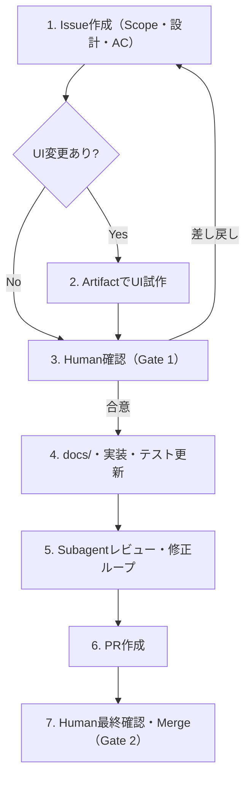
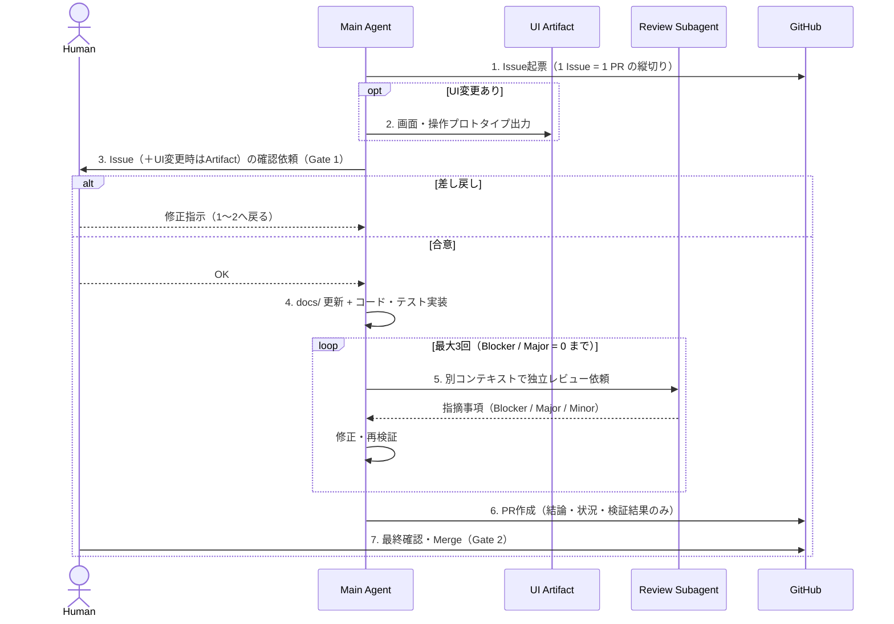
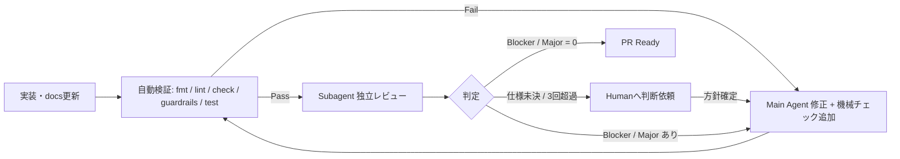
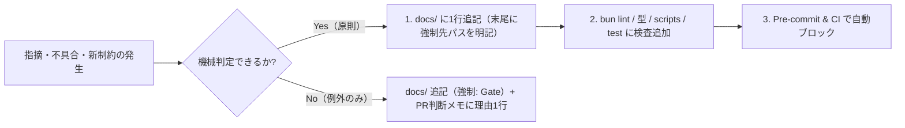
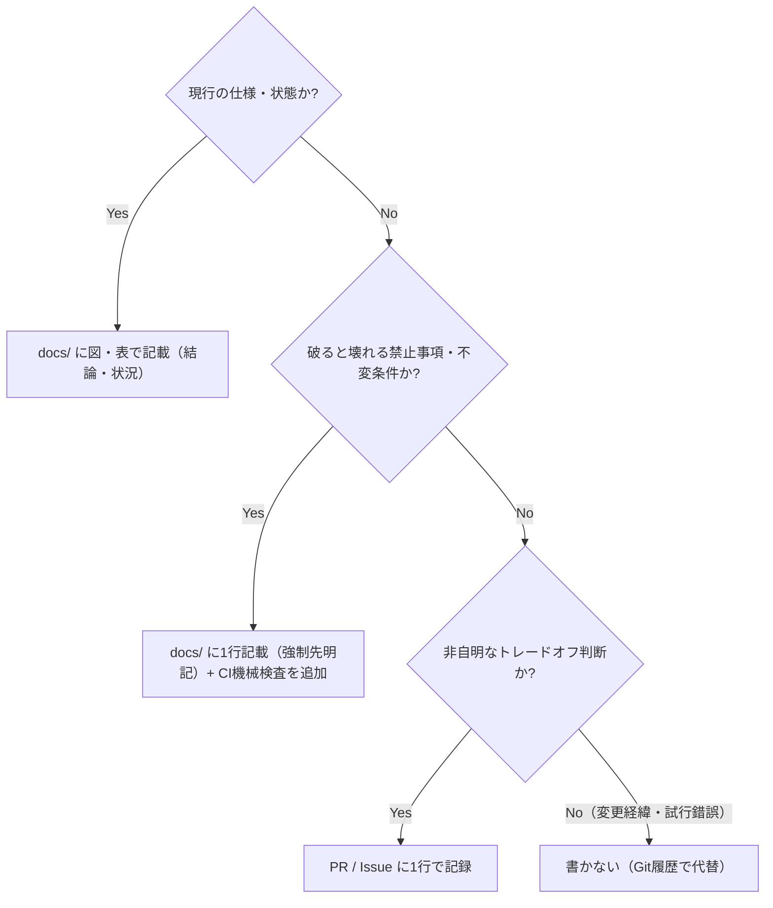
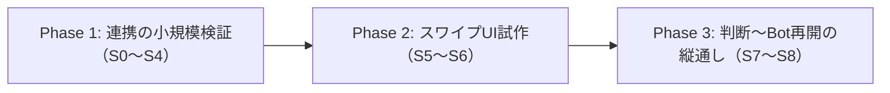

# AI開発フロー・ドキュメント規約

作成日：2026-11-18 ／ 状態：運用基準

## 1. 全体フロー



| #   | 工程               | 主担当              | 成果物                  | 完了条件（Exit Gate）                                                                                           |
| --- | ------------------ | ------------------- | ----------------------- | --------------------------------------------------------------------------------------------------------------- |
| 1   | Issue・設計        | Main Agent          | GitHub Issue            | Scope・設計図・AC・1行ガードレールが図表で明記                                                                  |
| 2   | UI試作（UI変更時） | Main Agent          | Artifact（HTML / 画像） | 通常・0件・読込・Bot実行中/未接続・失敗、SP（360/320px）＋PC代替操作を再現（UI変更なし時はIssue明記でスキップ） |
| 3   | 設計・UI確認       | **Human**           | 合意コメント            | 設計（＋UI変更時はArtifact）の合意完了                                                                          |
| 4   | Doc・実装          | Main Agent          | `docs/`・Code・Test     | 仕様書（結論・状況）と実装・テストが同時更新                                                                    |
| 5   | 自律レビュー       | **Subagent** × Main | 修正済ブランチ          | 自動検証Pass ＋ Subagent指摘 `Blocker / Major = 0`（最大3回）                                                   |
| 6   | PR作成             | Main Agent          | GitHub PR               | 結論・状況・検証結果のみを記載し提出                                                                            |
| 7   | 最終確認・Merge    | **Human**           | Merge Commit            | 差分・検証結果を確認し Merge                                                                                    |

- 禁止：Gate 1 合意前の本実装着手（強制: Gate）
- 禁止：GitHub Issues 無効のまま本実装へ進むこと（先にHumanへ有効化を依頼。本フロー定義PRのみ例外）（強制: Gate）

---

## 2. 役割分担と進行シーケンス



---

## 3. Subagent レビュー・修正ループ

- ルール：実装した Main Agent とは**別コンテキストの Subagent** で検証する（最大3回反復・超過時はHumanへエスカレーション）。



### 重大度（Severity）基準

| 重大度      | 定義                                                                                 |     PR可否     |
| ----------- | ------------------------------------------------------------------------------------ | :------------: |
| **Blocker** | 仕様矛盾、認可・データ境界破り、型・テスト失敗、描画・操作不能                       |      不可      |
| **Major**   | AC未達、競合・異常系漏れ、`docs/` 未更新、指摘に対する機械的再発防止（CI検査）の欠落 |      不可      |
| **Minor**   | 軽微な表現・構造改善提案                                                             | 可（任意対応） |

### レビュー観点一覧

| レビュー観点             | チェック項目                                                                                                                                                                    | 合格基準                    |
| ------------------------ | ------------------------------------------------------------------------------------------------------------------------------------------------------------------------------- | --------------------------- |
| **Spec / Doc整合**       | IssueのAC・[企画・要件書](concept.md)・[システム構成](architecture.md)・[データ・状態遷移](data-and-state.md)・[Bot連携・状態設計](bot-integration.md)との一致、`docs/`更新漏れ | 仕様乖離 0・Doc未更新 0     |
| **Security / 境界**      | 人専用APIとBot用MCPの分離、`workspace_id`・占有ロック・版検証（`BOT-02`, `DEC-02`）                                                                                             | 権限バイパス・競合漏れ 0    |
| **Code / Test / 機械化** | 型・Lint・検査スクリプト・単体/結合テスト、および**検出した指摘・不具合に対するCI機械検査の同梱**                                                                               | 全自動検証 Pass・再発防止済 |
| **UI / UX**（UI変更時）  | Artifact一致、SP操作域（44px以上）・PC代替操作、縦スクロール誤判定防止（`UX-01`〜`05`）                                                                                         | 表示崩れ・操作欠落 0        |

### 指摘・修正のCI機械化ラチェット原則（人・AIの注意力依存を排除）



|  優先順  | 変換先（ブレない順）                                       | 対象となる指摘・ルール                                                      | CI実行コマンド                 |
| :------: | ---------------------------------------------------------- | --------------------------------------------------------------------------- | ------------------------------ |
|  **1**   | **Linter / Formatter**（`bunfig.toml`）                    | レイヤー越境、禁止import・構文・グローバル変数、書式                        | `bun fmt --check` / `bun lint` |
|  **2**   | **型・コンパイル制約**（`tsconfig.json` / ブランド型）     | 認可証票の必須化、不正な引数・状態の組合せ                                  | `bun check`                    |
|  **3**   | **簡易検査スクリプト**（`scripts/check-guardrails.ts`）    | `docs/` 規約、強制先タグ欠落、リンク切れ、Mermaid構文違反、禁止パターン走査 | `bun run check:guardrails`     |
|  **4**   | **回帰・構造テスト**（`tests/guardrails/`・`tests/unit/`） | 競合タイミング、境界値、再発バグの再現テスト                                | `bun test`                     |
| **例外** | **文書＋Gate確認のみ**                                     | 機械判定が不可能なUX・仕様判断のみ（PR判断メモに機械化不可理由を1行明記）   | Subagent / Human Gate          |

- 禁止：レビュー指摘や不具合修正を `docs/` の文章追記のみで完了させること（強制: `scripts/check-guardrails.ts`, Gate）
- 禁止：検査スクリプト（`scripts/`）にネットワーク通信や非決定論的な判定を入れること（強制: `bunfig.toml`）

---

## 4. ドキュメント規約：「結論・状況のみ」の原則

> **結論：`docs/` には「結論（現行仕様）」「状況（現在地）」「1行ガードレール（末尾に強制先明記）」のみを書く。変更経緯・議論ログは書かない。**

### 「結論・状況のみ」にするかどうかの整理（AI開発における扱い）

| 項目                 |             要否             | AI開発での扱い・影響                                                                                                                                              |
| -------------------- | :--------------------------: | ----------------------------------------------------------------------------------------------------------------------------------------------------------------- |
| **結論＋状況**       |           **必須**           | 現行仕様と `未実装 / 実装済 / 検証済` の境界を固定し、推測実装や「対応済」誤記を防止                                                                              |
| **変更経緯・旧案**   |       **不要（有害）**       | 旧仕様が残るとAIが現行仕様と誤認して再実装するため削除（履歴は `git log` / PRへ分離）                                                                             |
| **変更理由（背景）** | **原則不要（例外のみ変換）** | 長文理由は不要。非自明な制約は**`禁止：〜（強制: <実在パス / S1〜S8予定 / Gate>）` の1行＋CI検査**へ変換して残す（トレードオフ根拠は必要時のみ Issue / PR に1行） |

- 既存初稿（[concept.md](concept.md) / [bot-integration.md](bot-integration.md)）の更新ルール：対象Issueのスコープ該当箇所のみ、合意・実装に合わせて「提案散文 → 確定仕様（図表＋状況＋1行ガードレール）」へ段階置換する（スコープ外の章は一括改稿しない）。

### 情報の振り分けフロー



### 媒体別の記述マトリクス

| 情報の種類                               | `docs/*.md` | Issue | Artifact |    PR     | ルール                                          |
| ---------------------------------------- | :---------: | :---: | :------: | :-------: | ----------------------------------------------- |
| **結論**（現行仕様・構造・I/O）          |      ◎      |   ◎   | ◎（UI）  | ○（差分） | 図・表を優先                                    |
| **状況**（未実装 / 実装済 / 検証済）     |      ◎      |   ◎   |    -     |     ◎     | 未検証を「対応済」にしない（CI検査）            |
| **ガードレール**（禁止事項・境界条件）   |      ○      |   ○   |    -     |     -     | `（強制: ...）` 付き1行で記載＋CI検査を同時追加 |
| **判断理由**（トレードオフの選択根拠）   |      ×      |   △   |    -     |     ○     | 必要な場合のみPR/Issueに1行                     |
| **変更経緯**（旧案・試行錯誤・修正履歴） |      ×      |   ×   |    ×     |     ×     | 書かない（見出し混入はCIで自動ブロック）        |

### 記述例（NG / OK 対比）

| 区分                               | 例                                                                                                                                                                                                        |
| ---------------------------------- | --------------------------------------------------------------------------------------------------------------------------------------------------------------------------------------------------------- |
| **NG**（経緯・長文）               | 当初はスワイプ直後に確定してBotを動かす想定だったが、スマホでの誤スワイプが懸念されたため議論の結果5秒間の取り消し猶予を設けることに変更した。そのため仮確定の間はBotが動かないように注意する必要がある。 |
| **OK**（結論・状況・ガードレール） | 状態：`pending ⇄ provisional(5s) → accepted / declined`（未実装・5s以内取消で `pending` 復帰）<br>禁止：`provisional` 中のBot着手・外部実行（`DEC-01`）（強制: `src/domain/card-state.ts`, `S3予定`）     |

### 視覚化フォーマット基準（日本語最小化）

| 表現対象                       | 使用フォーマット                | 避ける表現                   |
| ------------------------------ | ------------------------------- | ---------------------------- |
| 分岐・処理フロー・全体構成     | `mermaid` (`flowchart TD / LR`) | 順序を説明する長文段落       |
| 役割間の通信・時系列           | `mermaid` (`sequenceDiagram`)   | 主語が入れ替わる文章         |
| エンティティの状態遷移         | `mermaid` (`stateDiagram-v2`)   | 矢印テキストの羅列・文章説明 |
| 仕様項目・権限・比較・状況一覧 | Markdown Table                  | 箇条書きの長文化             |
| 補足ルール・禁止事項           | 1行箇条書き（体言止め・短文）   | 背景説明・接続詞の多用       |

---

## 5. Issue / PR 最小テンプレート

### Issue（設計・スコープ定義）

```markdown
## Goal / Status

- 結論：<1行で到達状態>
- 対象AC：`UX-01`, `DEC-01`（基盤タスク時は完了条件を1行記載）

## Scope

| In（やること） | Out（やらないこと） |
| -------------- | ------------------- |
| ...            | ...                 |

## Design

<Mermaid 図 + I/O・状態の表 + 1行ガードレール>

## UI Artifact

- <Artifact リンク / UI変更なし>
```

### Pull Request（結果・検証報告）

```markdown
Closes #<Issue番号>

## Changes（結論）

| 対象       | 変更内容 | 状態   |
| ---------- | -------- | ------ |
| `docs/...` | ...      | 更新済 |
| `src/...`  | ...      | 実装済 |

- 判断メモ（非自明なトレードオフ時のみ1行）：<なし / ...>

## Verification（確認結果）

- [ ] `bun fmt --check / bun lint / bun check / bun run check:guardrails / bun test` Pass
- [ ] Subagent Review：`Blocker / Major = 0`（指摘事項のCI機械化を含む）
- [ ] UI Artifact との整合確認（UI変更時） / `pulumi preview` Pass（`infra/` 変更時）
```

---

## 6. 現在の状況と開始ステップ



| 項目                                                          | 状況                                                             | 次のアクション                                    |
| ------------------------------------------------------------- | ---------------------------------------------------------------- | ------------------------------------------------- |
| 企画・要件（[concept.md](concept.md)）                        | 設計基準（S5 判断画面UI確定済）                                  | `S6` で残り画面の確定事項を段階置換               |
| システム構成（[architecture.md](architecture.md)）            | 構成基準（S0・S1・S2・S5 実装済）                                | `S3` で Better Auth・Human API 13本を実装         |
| データ・状態遷移（[data-and-state.md](data-and-state.md)）    | 実装基準（S1 DB・Domain遷移、S2 Botサービス・冪等・WorkLease済） | `S3` で Human判断・5秒Queue確定実装               |
| Bot連携・状態設計（[bot-integration.md](bot-integration.md)） | 実装基準（S2 `/api/mcp` 12ツール・D1認可境界 実装済）            | `S3`/`S4` で Human API・OAuth 2.1・検証環境を実装 |
| 実装計画（[implementation-plan.md](implementation-plan.md)）  | 計画基準（S0・S1・S2・S5 実装済）                                | 次は `S3` (#12) を実装                            |
| AI開発フロー（本書）                                          | 運用基準（CI自動強制済）                                         | 全変更に適用                                      |
| GitHub Issues / CI Gate                                       | 有効（`enabled` / `ci.yml`）                                     | 稼働中                                            |
