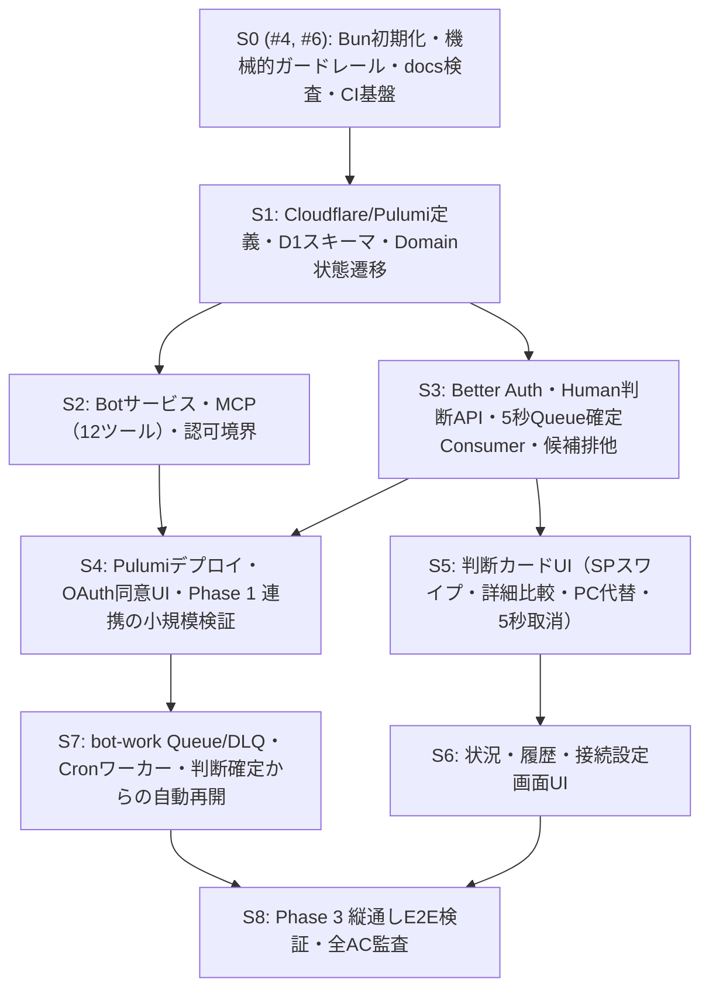

# 実装計画・Issue分割マップ

作成日：2026-11-18 ／ 状態：計画基準（S0 実装済 ／ S1〜S8 未着手）

## 1. フェーズと実装スライス依存フロー

[企画・要件書](concept.md) の実装順（「連携の小規模検証」→「スワイプ体験の試作」→「判断からBot再開までの縦通し」）を `1 Issue = 1 PR` の縦切りスライス（`S0`〜`S8`）に分割する。起票時に実GitHub Issue番号を紐付ける。

---

## 2. 実装スライス一覧

|      Slice      |  Phase  | スコープ（結論）                                                                                                                                                                                                                                                                                                            |            UI Artifact             | 主な検証対象                                                                                                   | 状態       |
| :-------------: | :-----: | --------------------------------------------------------------------------------------------------------------------------------------------------------------------------------------------------------------------------------------------------------------------------------------------------------------------------- | :--------------------------------: | -------------------------------------------------------------------------------------------------------------- | ---------- |
| **S0** (#4, #6) | Phase 1 | Bun初期化（`package.json` / `tsconfig.json` / `bunfig.toml`）、レイヤー越境遮断・`as` 禁止・マスクロガー、証票ブランド型（`OwnerContext` / `VerifiedBotContext`）、`scripts/check-guardrails.ts`（`docs/`・強制先検査）、`tests/guardrails/`、`.githooks/pre-commit`、GitHub Actions CI（`ci.yml`）＋ `main` Ruleset 必須化 |                不要                | `bun fmt --check / lint / check / check:guardrails / test`、`BOT-02`（静的・型境界）                           | **実装済** |
|     **S1**      | Phase 1 | Hono・React(Vite)・Drizzle 導入、Pulumi（`infra/`：`WorkersScript / D1Database / Queue×3 / QueueConsumer×3 / WorkersCronTrigger / WorkersRoute`）定義、Better Auth＋ドメイン全テーブル・部分一意制約・D1ガード付き `db.batch` 実装、`Task`・`DecisionCard` 純粋状態遷移テスト                                               |                不要                | `bun fmt --check / lint / check / check:guardrails / test`、`pulumi preview`、`DEC-03`, `DEC-04`（Domain単体） | 未着手     |
|     **S2**      | Phase 1 | `src/services/bot/`、`/api/mcp`（`@modelcontextprotocol/server` 12ツール・成果Upsert含む）、`request_id` 冪等性、`WorkLease` 排他、`bot_connections` D1照合認可（`scopes` / `paused` / `revoked` 境界）                                                                                                                     |                不要                | `BOT-02`, `DEC-02`（`bun test` 結合テスト）                                                                    | 未着手     |
|     **S3**      | Phase 1 | Better Auth 基盤（`/api/auth/*`・オーナー制限）、`/api/human/*`（CSRF検証付）、`src/services/system/` と `decision-finalize` 用 `queue()` Consumer＋読取時オンデマンド確定、5秒取消排他、候補グループロック、古い版の再確認カード化                                                                                         |                不要                | `DEC-01`〜`04`, `BOT-02`（`bun test` 結合テスト）                                                              | 未着手     |
|     **S4**      | Phase 1 | オーナー `/sign-in`・OAuth `/consent` 画面実装、`@better-auth/mcp`（OAuth 2.1・`/.well-known/*`・同意時 `bot_connections` Upsert）設定、Pulumi による Cloudflare 検証環境反映、対象Botクライアントでの認証→タスク作成→カード提出→5秒確定→結果取得の小規模実証記録                                                           | **必須**（`/sign-in`・`/consent`） | [bot-integration.md](bot-integration.md) 8章の経路別記録更新、`BOT-02`                                         | 未着手     |
|     **S5**      | Phase 2 | 判断画面UI（SP 360/320px、横スワイプ閾値・縦スクロール分離・SP画面端保護、カード詳細・成果プレビュー・候補比較、5秒取消、あとで、読込/0件/実行中/未接続/オフライン失敗表示、PCボタン/キーボード・44px操作域・視差軽減）                                                                                                     |              **必須**              | `UX-01`〜`05`, `DEC-01`（Playwright SP/PC）                                                                    | 未着手     |
|     **S6**      | Phase 2 | 状況画面（読み取り専用カンバン・待機/失敗理由・再試行ボタン）、履歴画面、初回設定・Bot接続管理（停止/失効/スコープ変更）画面UI                                                                                                                                                                                              |              **必須**              | `UX-01`, `UX-02`, `BOT-03`（Playwright SP/PC）                                                                 | 未着手     |
|     **S7**      | Phase 3 | Cloudflare Workers `bot-work` Queue Consumer（個別 `ack/retry`・1有界ステップ実行・`bot-work-dlq` 失敗記録）および `scheduled()`（Cron回収）実装、モデルAPIアダプター、判断確定後の `finalized_task_version` 検証と自動再開、回数・費用上限                                                                                 |                不要                | `BOT-01`, `BOT-03`, `DEC-01`, `DEC-03`（`bun test` 結合テスト）                                                | 未着手     |
|     **S8**      | Phase 3 | 初回設定→Bot提案→人スワイプ判断→Queueワーカー再開→履歴反映の縦通しE2Eと全12件ACの最終検証                                                                                                                                                                                                                                   |             変更時のみ             | `UX-01`〜`05`, `DEC-01`〜`04`, `BOT-01`〜`03`                                                                  | 未着手     |

- 禁止：前段スライスの完了条件（`bun check / fmt --check / lint / check:guardrails / test` Pass かつ Subagentレビュー `Blocker / Major = 0`）を満たさずに後続スライスをMergeすること（強制: `.github/workflows/ci.yml`, Gate）
- 禁止：`S4`・`S8` の実機/E2E確認前に各Bot経路を「対応済」と表示・記載すること（強制: `scripts/check-guardrails.ts`）

---

## 3. 受け入れ条件（AC）トレース表

| AC ID    | 要件（[concept.md](concept.md) 8章）                    |  実装スライス  | 最終E2E検証 |
| -------- | ------------------------------------------------------- | :------------: | :---------: |
| `UX-01`  | 初回設定後、1サイクルをタスク編集せずスワイプだけで進行 |     S5, S6     |     S8      |
| `UX-02`  | SPとPCで同じカードを読み、同じ判断を保存                |     S5, S6     |     S8      |
| `UX-03`  | 採用／見送りによる結果が操作前に分かる                  |       S5       |     S8      |
| `UX-04`  | 縦スクロールと閾値未満ドラッグで誤送信しない            |       S5       |     S8      |
| `UX-05`  | ボタン・キーボードでもスワイプと同じ結果になる          |       S5       |     S8      |
| `DEC-01` | 5秒以内の取り消し成功時、Botがその判断で着手しない      |   S3, S5, S7   |     S8      |
| `DEC-02` | 二重送信・2端末操作でも判断と後続作業が二重確定しない   |     S2, S3     |     S8      |
| `DEC-03` | 古いカード・変更済み提案の採用時は再確認用カードになる  |   S1, S3, S7   |     S8      |
| `DEC-04` | 候補の採用は1件のみ。全件見送り時に自動採用しない       |     S1, S3     |     S8      |
| `BOT-01` | 人の判断確定後、稼働中ワーカーが次作業を取得して再開    |       S7       |     S8      |
| `BOT-02` | Botは権限外タスクを読めず、人の判断も偽造できない       | S0, S2, S3, S4 |     S8      |
| `BOT-03` | 作業失敗時に完了と表示せず、理由と再試行状況が分かる    |     S6, S7     |     S8      |

---

## 4. 前提・未確定事項の扱い

| 項目                                  | 現状              | 扱い・解決タイミング                                                                                           |
| ------------------------------------- | ----------------- | -------------------------------------------------------------------------------------------------------------- |
| GitHub Issues 設定                    | 有効（`enabled`） | 解決済（`S0` 起票済・次は `S1` を起票して進行）                                                                |
| Muse の正式名称・URL                  | 未特定            | MVP初期（`S0`〜`S8`）は ChatGPT / Claude / Grok を先行対象とし、特定後に接続スライスを追加                     |
| 最初の利用実例                        | 未確定            | `S4` / `S7` 着手時のIssue設計で1例（例：アプリ企画・調査タスク分解）を確定                                     |
| 公式チャット接続 vs APIワーカー優先順 | 未確定            | Phase 1（`S2`〜`S4`）で共通MCP＋OAuthを検証し、Phase 3（`S7`）でCloudflare Queue ワーカー1経路の自律再開を検証 |
