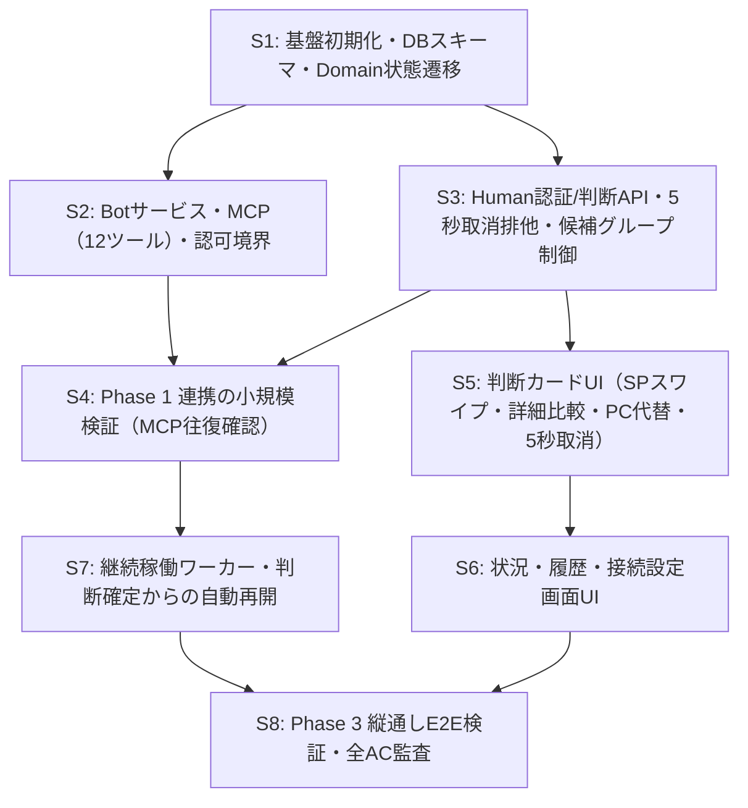

# 実装計画・Issue分割マップ

作成日：2026-11-18 ／ 状態：計画基準（未実装）

## 1. フェーズと実装スライス依存フロー

[企画・要件書](concept.md) の実装順（「連携の小規模検証」→「スワイプ体験の試作」→「判断からBot再開までの縦通し」）を `1 Issue = 1 PR` の縦切りスライス（`S1`〜`S8`）に分割する。起票時に実GitHub Issue番号を紐付ける。

---

## 2. 実装スライス一覧

| Slice | Phase | スコープ（結論） | UI Artifact | 主な検証対象 | 状態 |
| :---: | :---: | --- | :---: | --- | --- |
| **S1** | Phase 1 | Next.js / TS / Biome / Vitest / Drizzle 初期化、全11テーブル・部分一意制約作成、`Task`・`DecisionCard` 純粋状態遷移テスト | 不要 | `pnpm typecheck / lint / test`、`DEC-03`, `DEC-04`（Domain単体） | 未着手 |
| **S2** | Phase 1 | `src/services/bot/`、`/api/mcp`（12ツール）、`request_id` 冪等性、`WorkLease` 排他、`scopes` / `paused` / `revoked` 認可境界 | 不要 | `BOT-02`, `DEC-02`（Bot結合テスト） | 未着手 |
| **S3** | Phase 1 | Human認証（`sessions`・CSRF検証）、`src/services/human/`、`/api/human/*`、`src/services/system/`（5秒確定ジョブ排他）、候補グループロック、古い版の再確認化 | 不要 | `DEC-01`〜`04`, `BOT-02`（Human/System結合テスト） | 未着手 |
| **S4** | Phase 1 | MCP検証ハーネス作成、対象Botクライアントとの認証→タスク作成→カード提出→5秒確定→結果取得の小規模実証記録 | 不要 | [bot-integration.md](bot-integration.md) 8章の経路別記録更新 | 未着手 |
| **S5** | Phase 2 | 判断画面UI（SP 360/320px、横スワイプ閾値・縦スクロール分離・SP画面端保護、カード詳細・成果プレビュー・候補比較、5秒取消、あとで、読込/0件/実行中/未接続/オフライン失敗表示、PCボタン/キーボード・44px操作域・視差軽減） | **必須** | `UX-01`〜`05`, `DEC-01`（Playwright SP/PC） | 未着手 |
| **S6** | Phase 2 | 状況画面（読み取り専用カンバン・待機/失敗理由・再試行ボタン）、履歴画面、初回設定・Bot接続管理画面UI | **必須** | `UX-01`, `UX-02`, `BOT-03`（Playwright SP/PC） | 未着手 |
| **S7** | Phase 3 | `src/worker/` 常駐ループ、モデルAPIアダプター、判断確定後の `finalized_task_version` 検証と自動再開、回数・費用上限、異常終了時のDB再開 | 不要 | `BOT-01`, `BOT-03`, `DEC-01`, `DEC-03`（Worker結合テスト） | 未着手 |
| **S8** | Phase 3 | 初回設定→Bot提案→人スワイプ判断→ワーカー再開→履歴反映の縦通しE2Eと全12件ACの最終検証 | 変更時のみ | `UX-01`〜`05`, `DEC-01`〜`04`, `BOT-01`〜`03` | 未着手 |

- 禁止：前段スライスの完了条件（自動テスト・Subagentレビュー `Blocker / Major = 0`）を満たさずに後続スライスをMergeすること
- 禁止：`S4`・`S8` の実機/E2E確認前に各Bot経路を「対応済」と表示・記載すること

---

## 3. 受け入れ条件（AC）トレース表

| AC ID | 要件（[concept.md](concept.md) 8章） | 実装スライス | 最終E2E検証 |
| --- | --- | :---: | :---: |
| `UX-01` | 初回設定後、1サイクルをタスク編集せずスワイプだけで進行 | S5, S6 | S8 |
| `UX-02` | SPとPCで同じカードを読み、同じ判断を保存 | S5, S6 | S8 |
| `UX-03` | 採用／見送りによる結果が操作前に分かる | S5 | S8 |
| `UX-04` | 縦スクロールと閾値未満ドラッグで誤送信しない | S5 | S8 |
| `UX-05` | ボタン・キーボードでもスワイプと同じ結果になる | S5 | S8 |
| `DEC-01` | 5秒以内の取り消し成功時、Botがその判断で着手しない | S3, S5, S7 | S8 |
| `DEC-02` | 二重送信・2端末操作でも判断と後続作業が二重確定しない | S2, S3 | S8 |
| `DEC-03` | 古いカード・変更済み提案の採用時は再確認用カードになる | S1, S3, S7 | S8 |
| `DEC-04` | 候補の採用は1件のみ。全件見送り時に自動採用しない | S1, S3 | S8 |
| `BOT-01` | 人の判断確定後、稼働中ワーカーが次作業を取得して再開 | S7 | S8 |
| `BOT-02` | Botは権限外タスクを読めず、人の判断も偽造できない | S2, S3, S4 | S8 |
| `BOT-03` | 作業失敗時に完了と表示せず、理由と再試行状況が分かる | S6, S7 | S8 |

---

## 4. 前提・未確定事項の扱い

| 項目 | 現状 | 扱い・解決タイミング |
| --- | --- | --- |
| GitHub Issues 設定 | 有効（`enabled`） | 解決済（`S1` から順にGitHub Issueを起票して進行可能） |
| Muse の正式名称・URL | 未特定 | MVP初期（`S1`〜`S8`）は ChatGPT / Claude / Grok を先行対象とし、特定後に接続スライスを追加 |
| 最初の利用実例 | 未確定 | `S4` / `S7` 着手時のIssue設計で1例（例：アプリ企画・調査タスク分解）を確定 |
| 公式チャット接続 vs APIワーカー優先順 | 未確定 | Phase 1（`S2`〜`S4`）で共通MCPを検証し、Phase 3（`S7`）でAPIワーカー1経路の自律再開を検証 |
