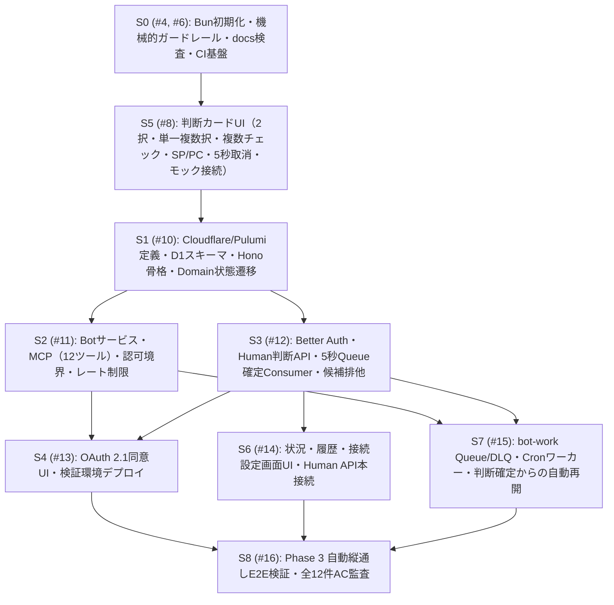

# 実装計画・Issue分割マップ

作成日：2026-11-18 ／ 状態：計画基準（S0〜S6 コード実装済 ／ S4 検証環境デプロイは認証情報設定後・S7〜S8 未着手）

## 1. フェーズと実装スライス依存フロー

[企画・要件書](concept.md) の実装順（「連携の小規模検証」→「スワイプ体験の試作」→「判断からBot再開までの縦通し」）を `1 Issue = 1 PR` の縦切りスライス（`S0`〜`S8`）に分割する。UI検証を先行するため `S5` は `DecisionCardClient` ポート＋モックアダプタで独立実装し、`S6` で実 Human API（`S3`）へ本接続する。全体の進捗・並行レーンは GitHub Issue `#22` で追跡する。

---

## 2. 実装スライス一覧

|      Slice      |  Phase  | スコープ（結論）                                                                                                                                                                                                                                                                                                              |            UI Artifact             | 主な検証対象                                                                                                                      | 状態                                                 |
| :-------------: | :-----: | ----------------------------------------------------------------------------------------------------------------------------------------------------------------------------------------------------------------------------------------------------------------------------------------------------------------------------- | :--------------------------------: | --------------------------------------------------------------------------------------------------------------------------------- | ---------------------------------------------------- |
| **S0** (#4, #6) | Phase 1 | Bun初期化（`package.json` / `tsconfig.json` / `bunfig.toml`）、レイヤー越境遮断・`as` 禁止・マスクロガー、証票ブランド型（`OwnerContext` / `VerifiedBotContext`）、`scripts/check-guardrails.ts`（`docs/`・強制先検査）、`tests/guardrails/`、`.githooks/pre-commit`、GitHub Actions CI（`ci.yml`）＋ `main` Ruleset 必須化   |                不要                | `bun fmt --check / lint / check / check:guardrails / test`、`BOT-02`（静的・型境界）                                              | **実装済**                                           |
|  **S1** (#10)   | Phase 1 | Hono・Zod・Drizzle・Better Auth 導入、Pulumi（`infra/`：`WorkersScript / D1Database / Queue×3 / QueueConsumer×3 / WorkersCronTrigger / RateLimit / Domain・Route`）定義、Better Auth＋ドメイン全テーブル・Partial Unique / `CHECK`・`guardedBatch`・`src/server/app.ts`・`build:worker`、`Task` / `DecisionCard` 純粋状態遷移 |                不要                | `bun fmt --check / lint / check / check:guardrails / test / build:worker / infra:preview`、`DEC-01`, `DEC-03`, `DEC-04`, `BOT-03` | **実装済**                                           |
|  **S2** (#11)   | Phase 1 | `src/services/bot/`、`/api/mcp`（`@modelcontextprotocol/server` 12ツール・成果Upsert含む）、`request_id` 冪等性、`WorkLease` 排他、`bot_connections` D1照合認可（`scopes` / `paused` / `revoked` 境界）、`/api/mcp` レート制限（`429 RATE_LIMITED`）                                                                          |                不要                | `BOT-02`, `DEC-02`（`bun test` 結合テスト）                                                                                       | **実装済**                                           |
|  **S3** (#12)   | Phase 1 | Better Auth 基盤（`/api/auth/*`・GitHub OAuth 単一オーナー制限）、`/api/human/*` 全13本（CSRF検証・レート制限付）、`src/services/system/` と `decision-finalize` 用 `queue()` Consumer＋読取時オンデマンド確定、5秒取消排他、候補グループロック、古い版の再確認カード化                                                       |                不要                | `DEC-01`〜`04`, `BOT-02`（`bun test` 結合テスト）                                                                                 | **実装済**                                           |
|  **S4** (#13)   | Phase 1 | オーナー `/sign-in`・OAuth `/consent` 画面実装、共通SPAルーティング、`@better-auth/mcp`（OAuth 2.1・`/.well-known/*`・DCR・同意時 `bot_connections` Upsert）設定、Pulumi 検証環境反映、OAuth 発行・失効スモーク検証                                                                                                           | **必須**（`/sign-in`・`/consent`） | [bot-integration.md](bot-integration.md) 8章・`BOT-02`（Unit + Playwright SP/PC）                                                 | **コード実装済**（検証環境デプロイは認証情報設定後） |
|   **S5** (#8)   | Phase 2 | 判断画面UI（2択・単一複数択・複数チェック統一操作、SP 360/320px、横スワイプ閾値・縦スクロール分離・SP画面端保護、カード詳細・成果プレビュー・候補比較、5秒取消、あとで、6状態表示、PC 2カラム・ボタン/キーボード・44px操作域・視差軽減、`DecisionCardClient` ポート＋モック実装）                                             |         **必須**（合意済）         | `UX-01`〜`05`, `DEC-01`, `DEC-04`（Unit + Playwright SP 360/320px・PC）                                                           | **実装済**                                           |
|  **S6** (#14)   | Phase 2 | 状況画面（Bot別進捗・読み取り専用カンバン・待機/失敗理由・再試行ボタン）、履歴画面、初回設定・Bot接続管理（構造化 `budget_limit`・`is_paused`・スコープ変更・2段階失効・Worker Bearer発行）画面UI、および `DecisionCardClient` の `/api/human/*` 本接続                                                                       |         **必須**（合意済）         | `UX-01`, `UX-02`, `BOT-03`（Playwright SP/PC）                                                                                    | **実装済**                                           |
|  **S7** (#15)   | Phase 3 | Cloudflare Workers `bot-work` Queue Consumer（個別 `ack/retry`・1有界ステップ実行・`bot-work-dlq` 失敗記録）および `scheduled()`（Cron 4責務）実装、モデルAPIアダプター共通層＋`grok.ts`、判断確定後の `finalized_task_version` 検証と自動再開、構造化 `budget_limit` 強制                                                    |                不要                | `BOT-01`, `BOT-03`, `DEC-01`, `DEC-03`（`bun test` 結合テスト）                                                                   | 未着手                                               |
|  **S8** (#16)   | Phase 3 | 初回設定→Bot提案→人スワイプ判断→Queueワーカー再開→履歴反映の自動縦通しE2Eと全12件ACの最終検証                                                                                                                                                                                                                                 |             変更時のみ             | `UX-01`〜`05`, `DEC-01`〜`04`, `BOT-01`〜`03`                                                                                     | 未着手                                               |

- 禁止：前段スライスの完了条件（`bun check / fmt --check / lint / check:guardrails / test` Pass かつ Subagentレビュー `Blocker / Major = 0`）を満たさずに後続スライスをMergeすること（強制: `.github/workflows/ci.yml`, Gate）
- 禁止：`S4`・`S8` の実機/E2E確認前に各Bot経路を「対応済」と表示・記載すること（強制: `scripts/check-guardrails.ts`）

---

## 3. 受け入れ条件（AC）トレース表

| AC ID    | 要件（[concept.md](concept.md) 8章）                    |  実装スライス  | 最終E2E検証 |
| -------- | ------------------------------------------------------- | :------------: | :---------: |
| `UX-01`  | 初回設定後、1サイクルをタスク編集せずスワイプだけで進行 |     S5, S6     |     S8      |
| `UX-02`  | SPとPCで同じカードを読み、同じ判断を保存                |     S5, S6     |     S8      |
| `UX-03`  | 採用／見送りによる結果が操作前に分かる                  |       S5       |     S8      |
| `UX-04`  | 縦スクロールと閾値未満ドラッグで誤送信しない            |       S5       |     S8      |
| `UX-05`  | ボタン・キーボードでもスワイプと同じ結果になる          |       S5       |     S8      |
| `DEC-01` | 5秒以内の取り消し成功時、Botがその判断で着手しない      | S1, S3, S5, S7 |     S8      |
| `DEC-02` | 二重送信・2端末操作でも判断と後続作業が二重確定しない   |     S2, S3     |     S8      |
| `DEC-03` | 古いカード・変更済み提案の採用時は再確認用カードになる  |   S1, S3, S7   |     S8      |
| `DEC-04` | 候補の採用は1件のみ。全件見送り時に自動採用しない       |   S1, S3, S5   |     S8      |
| `BOT-01` | 人の判断確定後、稼働中ワーカーが次作業を取得して再開    |       S7       |     S8      |
| `BOT-02` | Botは権限外タスクを読めず、人の判断も偽造できない       | S0, S2, S3, S4 |     S8      |
| `BOT-03` | 作業失敗時に完了と表示せず、理由と再試行状況が分かる    |   S1, S6, S7   |     S8      |

---

## 4. 前提・未確定事項の扱い

| 項目                                  | 現状                   | 扱い・解決タイミング                                                                                                   |
| ------------------------------------- | ---------------------- | ---------------------------------------------------------------------------------------------------------------------- |
| GitHub Issues 設定                    | 有効（`enabled`）      | 解決済（Milestone `MVP`・ロードマップ `#22`・`S0`〜`S6` コード実装済、`#13` 検証デプロイ・`S7`/`S8` 未実施）           |
| Muse の正式名称・URL                  | 未特定（`#19` 起票済） | MVP初期（`S0`〜`S8`）は ChatGPT (`#17`) / Claude (`#20`) / Grok (`#18`) を先行対象とし、特定後に接続スライスを追加     |
| 最初の利用実例                        | 確定                   | 「アプリ企画・競合調査タスク分解 → 方針判断 → 調査成果提出」（`S4`・`S7`・`S8`・`#17`/`#18`/`#20` の共通検証シナリオ） |
| 公式チャット接続 vs APIワーカー優先順 | 確定                   | Phase 1（`S2`〜`S4`）で共通MCP＋OAuth 2.1を整備し、Phase 3（`S7`・`#18`）で Cloudflare Queue + xAI API 自動再開を実装  |
